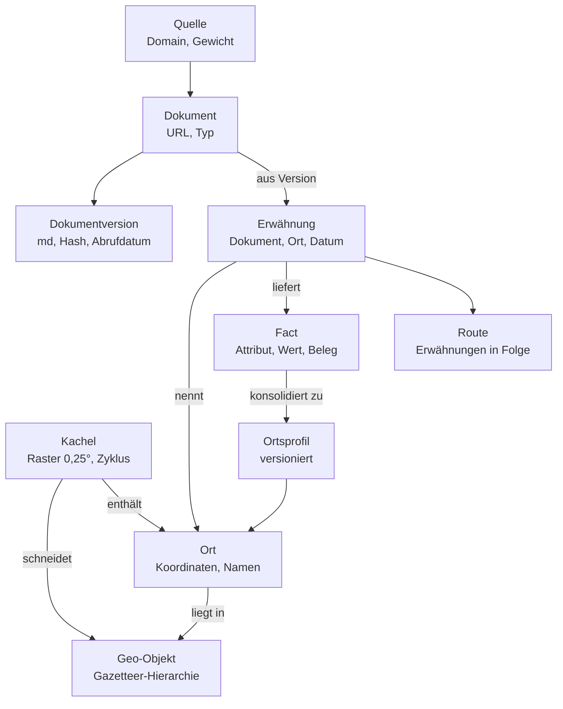
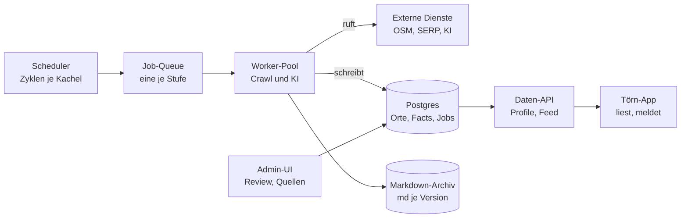

# Ankerplatz-Datendienst (DSTAP): Spec und Output-Vertrag

Stand: 18. Oktober 2026 · Autor: Christian · Status: Konzept, Grundlage für den Piloten Saronischer Golf

Dieses Dokument hat zwei Teile. Teil A beschreibt den Datendienst selbst: Prinzipien, Datenmodell, Pipeline, Betrieb, Pilot. Teil B ist der Output-Vertrag, also das, was der Datendienst an die Törn-App liefert; er ist der verbindliche Teil für die Implementierung auf beiden Seiten. Offene Punkte stehen am Ende jedes Teils.

Quelle der beiden Teile sind die Claude Docs „Spec: Ankerplatz-Datendienst (DSTAP)“ und „Output-Vertrag: Datendienst → Törn-App“ vom 18.10.2026; diese Datei ist der Stand für das Repo.

## Inhalt

- Teil A: Spezifikation des Datendienstes
- Teil B: Output-Vertrag Datendienst → Törn-App

---

# Teil A: Spezifikation des Datendienstes

## Zweck und Abgrenzung

Der Dienst baut und pflegt dauerhaft die Wissensbasis über Ankerplätze, Marinas und Routen, aus der die Törn-App (DSTAP) liest. Er läuft ohne Zutun: er findet Quellen, liest sie, leitet Fakten ab, prüft jede Koordinatenkachel nach Zyklus erneut und meldet Änderungen.

Der Dienst ist:

- ein eigener Backend-Service mit eigener Datenbank und eigener Admin-Oberfläche
- die einzige Quelle, aus der die Törn-App Orts- und Routendaten bezieht
- ein Archiv aller gelesenen Quelldokumente mit Zeitstempel, nutzbar für Törn-Verifikation, Highlights und spätere Auswertungen

Der Dienst ist nicht:

- Teil der Törn-App (kein gemeinsames Schema, kein gemeinsamer Code; nur eine API dazwischen)
- ein Routenplaner (Wetter, Polardiagramm, Schlagberechnung bleiben in der Törn-App)
- ein Navily-Import (Navily dient nur als Stichprobe zur Verifikation)

Arbeitsname in dieser Spec: Datendienst. Ein eigener Name ist offen.

## Grundprinzipien

1. **Alles auf der Zeitachse.** Kein Datensatz wird überschrieben. Dokumente, Facts und Ortsprofile tragen ein Gültig-ab-Datum; eine Änderung erzeugt eine neue Version, die alte bleibt lesbar. Die Frage „Wie sah die Bucht im Juni 2025 aus?“ muss beantwortbar sein.
2. **Gazetteer und Kacheln, beides.** Takt und Vollständigkeit steuert die Kachel eines festen Rasters (0,25° × 0,25°, im Mittelmeer rund 22 × 28 km): eigener Zyklus, Priorität und Stand je Kachel. Sprache und Quellen steuert der Gazetteer: ein Verzeichnis aller benannten Geo-Objekte (Meer, Revier, Insel, Küstenabschnitt, Ort) mit Geometrie und Namensvarianten, aus OSM, GeoNames und Wikidata aufgebaut. Suchbegriffe kommen aus dem Gazetteer, Abdeckung wird je Kachel gemessen; eine Küstenkachel ohne Revier ist eine Lücke im Gazetteer.
3. **Berechnen vor Lesen.** Was sich aus Küstenlinie und Bathymetrie ableiten lässt (Schutz je Windsektor, Tiefe, Grund, Öffnung zur See), wird für jeden Ort berechnet und ist damit flächendeckend. Texte bestätigen, korrigieren und ergänzen die Berechnung; sie sind nie die einzige Quelle für ein berechenbares Attribut.
4. **Rohmaterial ist das Asset.** Jede gelesene Seite wird als Markdown mit URL, Abrufdatum und Hash archiviert. Alles Abgeleitete lässt sich daraus jederzeit neu berechnen, auch mit besseren Modellen oder einem erweiterten Schema.
5. **Kein Fact ohne Beleg.** Jeder Fact zeigt auf ein Dokument und ein wörtliches Zitat daraus, oder auf eine Berechnung mit Eingangsdaten. Was sich nicht belegen lässt, wird nicht gespeichert.
6. **Quellen-first, Orte-second.** Wenige gute Quellen werden vollständig gelesen; die KI findet darin die Orte. Gezielte Suche pro Ort nur zum Lückenschließen.
7. **Beobachtungsdatum vor Veröffentlichungsdatum.** Ein Törnbericht vom Mai 2024 beschreibt die Bucht im Mai 2024, auch wenn er 2025 erschien. Dieses Datum entscheidet bei Widersprüchen.
8. **Facts auf jeder Ebene.** Meltemi-Exposition, Fährverkehr, Sperrgebiete und Charterbasen gehören zum Revier, Passagen und Gefahren zu Kap oder Enge, Schutz und Taverne zum Ort. Facts hängen am Geo-Objekt der passenden Ebene, nicht nur am Ankerplatz.
9. **Unabhängig von Navily und Google.** Seed aus offenen Daten, Facts aus öffentlichen Texten und Berechnung. Navily nur als Stichprobe; Google Places nur als Live-Layer der App über gespeicherte place_ids, nie als gespeicherte Daten.
10. **Mensch nur an den Rändern.** Der Dienst läuft autonom; Menschen bestätigen neue Ortskandidaten, entscheiden Konflikte, pflegen die Quellen-Whitelist und entscheiden Abweichungen zum Navily-Vergleichssatz.
11. **Mehrsprachig von Anfang an.** Quellen in Deutsch, Englisch, Griechisch, Italienisch, Kroatisch; Namensvarianten gehören zum Ort, nicht zur Quelle.

## Datenmodell

Zwölf Entitäten, alle mit Zeitbezug. Geo-Objekte, Orte und Quellen sind stabil, Dokumentversionen und Facts wachsen nur an, Ortsprofile werden pro Lauf neu versioniert.



Oben der Gazetteer, links das Stabile (Kachel, Ort, Quelle), rechts das Abgeleitete (Ortsprofil, Fact, Dokumentversion); Erwähnung ist das Scharnier zwischen Text und Ort.

| Entität | Zweck | Wichtige Felder |
| --- | --- | --- |
| Geo-Objekt | Gazetteer: jedes benannte Objekt der Küste in einer Hierarchie | typ (meer, revier, insel, kuestenabschnitt, kap, enge, bucht, hafen, ort), eltern_id, geometrie (Punkt oder Polygon), osm_id, geonames_id, wikidata_id, quelle, gueltig_ab |
| Kachel | Zelle des festen Rasters; steuert Umfang und Revisit-Zyklus | id (Spalte, Zeile), bounding_box, hat_kueste, geo_objekte (berechnet: alle, die die Kachel schneiden), zyklus_tage, prioritaet, letzter_lauf, naechster_lauf |
| Ort | Ankerplatz, Marina, Hafen, Boje; ein Geo-Objekt mit nautischer Bedeutung | geo_objekt_id, typ, lat, lon (Buchtmitte), ankerposition (lat, lon, konfidenz, herkunft), status (kandidat, bestaetigt, verworfen, aufgegeben, kein_ankerplatz), kachel_id, gueltig_ab, gueltig_bis |
| Externe Referenz | Schlüssel zu Live-Diensten, nie deren Inhalte | ort_id, dienst (google_places), externe_id (place_id), kategorie (siehe Highlight-Kategorien), suchradius_m, abgefragt_am; wird je Kachel-Lauf erneuert |
| Name | Namensvarianten je Geo-Objekt | geo_objekt_id, name, sprache, schrift (lateinisch, griechisch), herkunft (osm, geonames, wikidata, text, review) |
| Quelle | Domain oder Datensatz mit Qualitätsgewicht | domain, typ (revierfuehrer, toernbericht, forum, marina, behoerde, datensatz, berechnung), format (html, pdf, tabelle, geodaten), sprache, gewicht 0–1, crawl_regeln, aktiv |
| Dokument | Eine URL oder eine Datei | quelle_id, url, dokumenttyp, erstmals_gesehen, zuletzt_geprueft, status (aktiv, verschwunden) |
| Dokumentversion | Der Inhalt zu einem Zeitpunkt, in Chunks mit Embedding | dokument_id, abgerufen_am, hash, sprache, md_pfad, veroeffentlicht_am, beobachtet_am, chunks (text, embedding) |
| Erwähnung | Dokumentversion nennt ein Geo-Objekt | dokumentversion_id, geo_objekt_id, textausschnitt, position_im_text, beobachtet_am, konfidenz, match_art (deterministisch, modell, review) |
| Fact | Eine belegte Aussage über ein Geo-Objekt jeder Ebene | geo_objekt_id, erwaehnung_id oder berechnung_id, attribut, wert (JSON), beleg_zitat oder eingangsdaten, beobachtet_am, konfidenz, modell, extraktions_lauf |
| Beobachtung | Was eine Crew vor Ort festgestellt hat (später: Tracks und Meldungen aus der Törn-App) | ort_id, art (ankerstopp, meldung), position, von, bis, attribute (JSON), quelle (app, nutzer), konfidenz |
| Ortsprofil | Konsolidierte Sicht, versioniert | geo_objekt_id, version, gueltig_ab, attribute (JSON), konfidenz_je_attribut, herkunft_je_attribut (berechnet, text, beobachtung), konflikte, quellen_anzahl, erzeugt_am |

Dazu kommen Route (Abfolge von Erwähnungen eines Törnberichts mit Datum je Stopp), Lauf (ein Pipeline-Durchlauf mit Kachel, Stufe, Kosten, Ergebnis) und Review-Aufgabe (offene Entscheidung für einen Menschen).

Das Fact-Schema (Attribute) ist eine versionierte Konfiguration, kein Code, und je Ebene definiert. Ort: Schutz je Windsektor (N, NO, O, SO, S, SW, W, NW; berechnet und aus Text), Öffnung zur See, Tiefe min/max, Grund, Haltekraft, Schwell, Liegeart, Bojen, Kapazität, Belegung je Monat (leer, mäßig, voll), Wasser, Strom, Diesel, Dinghy-Anlandung, Verbote, Gefahren, Highlights je Kategorie (Tabelle unten; Taverne und Einkauf sind Highlight-Kategorien), Saisonhinweise, Preise, Kontakt/Buchung (Marina). Revier und Insel: Meltemi-Exposition, typische Windsysteme je Saison, Fährverkehr, Sperrgebiete, Charterbasen, Versorgungsorte. Kap und Enge: Passagehinweise, Seegang, Gefahren.

Highlights sind je Ort in acht Kategorien gegliedert. Jede Kategorie ist ein eigenes Fact mit Wert (vorhanden, Anzahl, Beschreibung, Saison, Konfidenz) und eigener Herkunft; die Externe Referenz hält dazu die place_ids, mit denen die App Bewertungen und Öffnungszeiten live nachlädt. Der Planer rechnet nur mit den eigenen Facts.

| Kategorie | Was dazugehört | Eigene Quellen (gespeichert) | Live-Layer in der App |
| --- | --- | --- | --- |
| Gastronomie | Tavernen, Restaurants, Bars, Cafés; Dinghy-Steg, Reservierung | OSM amenity=restaurant/cafe/bar, Törnberichte, Crew-Bestätigungen | Google Places: restaurant, cafe, bar |
| Versorgung | Supermarkt, Bäcker, Wasser, Diesel, Gas, Apotheke, Geldautomat | OSM shop=*, amenity=fuel/pharmacy/atm, Marina-Seiten | Google Places: supermarket, bakery, pharmacy, atm |
| Strand und Baden | Sandstrand, Kiesstrand, Badebucht, Schatten, Strandbar | OSM natural=beach, leisure=beach_resort, Törnberichte | Google Places: beach (Fotos) |
| Natur | Schnorcheln, Höhlen, Klippen, Schildkröten, Delfine, Naturschutzgebiet | OSM natural=*, EMODnet Schutzgebiete, Törnberichte | keiner |
| Wandern und Aktiv | Wanderwege, Aussichtspunkte, Kajak, Tauchen, Fahrrad | OSM highway=path mit sac_scale, tourism=viewpoint, shop=scuba_diving | Google Places: tourist_attraction, hiking_area |
| Kultur und Geschichte | Ruinen, Klöster, Burgen, Museen, Leuchttürme, Dörfer | OSM historic=*, tourism=museum, Wikidata, Wikivoyage | Google Places: museum, church, historical_landmark |
| Ort und Leben | Dorfplatz, Markt, Feste, Nachtleben, Hafenatmosphäre | OSM place=village, Wikivoyage, Törnberichte | Google Places: night_club, market |
| Ruhe und Abgeschiedenheit | Einsame Bucht, kein Verkehr, Sternenhimmel; das Gegenteil der anderen Kategorien | Berechnet aus Abstand zu Orten und Straßen, Törnberichte, Belegung | keiner |

Die Kategorien tragen eine Tonalität für den Planer: Eine Crew, die „Ruhe“ gewichtet, bekommt andere Vorschläge als eine, die „Gastronomie“ und „Ort und Leben“ gewichtet. Die Zuordnung von OSM-Tags und Google-Typen zu Kategorien ist Konfiguration, kein Code.

## Verarbeitungsstufen

Acht Stufen, jede als eigener Job-Typ mit eigener Queue. Stufen 1 bis 3 arbeiten ohne Texte und liefern schon ein vollständiges, wenn auch grobes Profil für jeden Ort; die Stufen 4 bis 8 verfeinern es aus Texten. Jede Stufe ist idempotent: ein Wiederanlauf erzeugt keine Dubletten, weil Dokumente über Hash und Facts über (Erwähnung, Attribut, Extraktionslauf) eindeutig sind.

1. **Gazetteer.** Aufbau des Verzeichnisses aller benannten Geo-Objekte für den gesamten Zielraum: aus OSM (Relationen für Meere und Golfe, place=island/islet, place=town/village an der Küste, natural=bay, natural=cape, natural=strait, seamark harbour/marina/anchorage, dazu POIs wie Tavernen, Strände, Ruinen) mit Geometrie und mehrsprachigen Namen; GeoNames und Wikidata ergänzen Namensvarianten, Transliterationen, IDs und Sehenswürdigkeiten; Wikivoyage liefert Reisetexte als Dokumente. Reviere entstehen aus Meeres- und Golf-Relationen plus den Inhaltsverzeichnissen der großen Revierführer, von der KI zu Polygonen und Namenslisten verdichtet, dann Review (Mittelmeer: geschätzt 60 bis 100 Reviere). Jedes Geo-Objekt erhält seine Eltern (Ort → Insel → Revier → Meer); jede Kachel bekommt die Liste der Geo-Objekte, die sie schneidet. Küstenkacheln ohne Revier gehen in die Review-Queue. Der Abgleich mit OSM läuft jährlich.
2. **Seed.** Ortskandidaten sind die Geo-Objekte nautischer Typen (Bucht, Hafen, Marina, Ankerplatz, Boje) innerhalb der Kachel, ergänzt um Buchten, die die Geometrie-Analyse (Stufe 3) als ankerbar erkennt, aber in keiner Quelle einen Namen haben. Verbote aus amtlichen Daten (Kabel, Militär, Schutzgebiete aus EMODnet Human Activities; Fährkorridore aus der Schiffsdichte; Dauer-Schießgebiete aus der NAVTEX-Historie) setzen den Status kein_ankerplatz, damit der Planer sie nie vorschlägt. Aktuelle NAVTEX-Warnungen (Übungen, Kabelarbeiten) sind kein Teil der Datenbasis, sondern ein Live-Layer der Törn-App zum Törnzeitpunkt. Kandidaten ohne Erwähnung nach dem ersten Lauf bleiben Kandidaten.
3. **Geometrie und Bathymetrie.** Für jeden Ort werden aus Küstenlinie (OSM), Bathymetrie (EMODnet, ersatzweise GEBCO) und Meeresboden (EMODnet Seabed Habitats) berechnet: Schutz je Windsektor aus Öffnungswinkel und Landabdeckung, Fetch-Länge je Sektor, Tiefe in 50, 100 und 200 m vor der Bucht, Grundtyp, nutzbare Ankerfläche zwischen 3 und 12 m, eine erste Ankerposition (Mitte der Ankerfläche, niedrige Konfidenz). Ergebnis sind Facts mit Herkunft „berechnet“ und den Eingangsdaten als Beleg. Die Berechnung läuft neu, wenn sich Eingangsdaten oder Regeln ändern.
4. **Quellenfindung.** DataForSEO SERP auf zwei Ebenen. Revier-Ebene: Reviernamen × Sprache × Template („Törnbericht {Revier}“, „{Revier} anchorages“, „Revierführer {Revier}“) liefert die großen Dokumente, die viele Orte auf einmal nennen. Kachel-Ebene: Namen der Inseln, Küstenorte und größeren Buchten der Kachel × Sprache × Template („Ankerplatz {Name}“, „anchorage {Name}“, „αγκυροβόλιο {Name}“) schließt Lücken bei kleinen Inseln. Dazu der Linkgraph: ausgehende Links der freigegebenen Quellen werden nach Domain gezählt; Domains, auf die mehrere gute Quellen verweisen, sind Quellenvorschläge ohne SERP. URLs werden nach Domain aggregiert. Neue Domains mit mindestens 3 Treffern landen als Quellenvorschlag in der Review-Queue; freigegebene Quellen erhalten Typ, Gewicht und Crawl-Regeln. Bekannte Quellen werden ohne SERP direkt gecrawlt.
5. **Fetch.** Pro Quelle ein Crawl innerhalb der Crawl-Regeln (erlaubte Pfade, maximale Tiefe, Rate-Limit, robots.txt). HTML wird zu Markdown, PDF (Revierführer, Hafenhandbücher, amtliche Listen) über Textextraktion mit Layout-Erhalt zu Markdown, Tabellen und Geodaten bleiben strukturiert. Jede Seite wird als Dokumentversion gespeichert und in Chunks von etwa 500 Wörtern mit Embedding abgelegt. Gleicher Hash wie die letzte Version: nur zuletzt_geprueft wird gesetzt, keine neue Version. HTTP 404/410 über zwei Läufe: Dokument wird auf verschwunden gesetzt, seine Facts bleiben mit Endedatum erhalten.
6. **Klassifikation und Erwähnungen.** Zuerst deterministisch: Trigram-Fuzzy-Match aller Chunk-Texte gegen die Namen des Gazetteers, Kandidaten auf die Geo-Objekte der Kachel, ihrer acht Nachbarkacheln und der im Dokument bereits erkannten Reviere eingeschränkt. Nur mehrdeutige Treffer (gleicher Name an mehreren Orten, Transliterationen) gehen an ein kleines Modell zur Disambiguierung, mit Chunk und den in Frage kommenden Geo-Objekten als Kontext. Pro Dokumentversion zusätzlich: Dokumenttyp, Sprache, Veröffentlichungs- und Beobachtungsdatum. Erwähnungen von Inseln und Revieren werden ebenso gespeichert wie die von Orten. Namen, die zu keinem Geo-Objekt passen, aber in zwei Dokumenten vorkommen, werden geocodiert (Nominatim, Umkreis 20 km zur Kachel) und gehen als neue Kandidaten in die Review-Queue.
7. **Fact-Extraktion.** Stärkstes Modell, pro Erwähnung und Chunk. Facts gegen das Schema der jeweiligen Ebene (Ort, Insel, Revier, Kap), jeweils mit Belegzitat, Konfidenz und beobachtet_am. Ohne Belegzitat im Text wird der Fact verworfen. Für Dokumenttyp Törnbericht zusätzlich: Route mit Abfolge der Stopps, Datum je Stopp, Schlag-Hinweise (Distanz, Dauer, Windbedingungen).
8. **Konsolidierung.** Pro Geo-Objekt ein neues Profil aus allen Facts, Berechnungen und Beobachtungen, mit einer Regel je Attribut statt eines allgemeinen Mittels: Schutz je Sektor = berechneter Wert, durch Texte um höchstens eine Stufe korrigiert, bei Widerspruch der schlechtere Wert; Tiefe und Grund = Bathymetrie, Texte nur als Korrektur bei Konfidenz über 0,8; Taverne, Bojen, Wasser = jüngste Beobachtung gewinnt, bei gleichem Alter die stärkere Quelle; Belegung = Verteilung über Monate aus allen Beobachtungen; Highlights = Vereinigung, nach Nennungen sortiert; Verbote = jede Nennung gilt, bis eine jüngere amtliche Quelle sie aufhebt. Widersprüche mit beiden Werten und Daten als Konflikt markieren; ein Konflikt mit eindeutigem Zeitverlauf (Taverne 2019 ja, 2024 nein) wird als Änderung gewertet, ohne Zeitverlauf als Review-Aufgabe. Jedes Profil erhält eine Lückenliste (Attribute ohne Fact) und je Attribut die Herkunft; Orte mit weniger als zwei Dokumenten lösen Stufe 4 gezielt per Ort aus. Ein Ort gehört zu genau einer Kachel (seine Koordinate); Dokumente und Quellen sind kachelunabhängig.

Stufen 6 bis 8 laufen auch ohne neue Dokumente erneut, wenn sich Schema oder Modell ändern (Reprozessierung über Extraktionslauf-Kennung).

## Zeitachse und Wiederholung

Jede Kachel hat einen eigenen Revisit-Zyklus; der Scheduler plant den nächsten Lauf aus Zyklus, Saison und Priorität. Standard sind 6 Monate für Kacheln in aktiven Charterrevieren, 12 Monate für den Rest; Kacheln ohne Küste laufen nie.

| Zyklus | Was läuft | Auslöser |
| --- | --- | --- |
| Täglich | Fetch bekannter Quellen mit hoher Änderungsrate (Blogs, Foren, Marina-News); nur neue oder geänderte Seiten | Scheduler |
| Wöchentlich | Konsolidierung aller Orte mit neuen Facts; Change-Feed an die Törn-App | Scheduler |
| Je Kachel, 6 oder 12 Monate | Voller Lauf: Seed-Abgleich, SERP-Quellenfindung auf beiden Ebenen, kompletter Crawl der Whitelist, Reprozessierung | Scheduler, Vorsaison bevorzugt |
| Jährlich | Gazetteer-Abgleich mit OSM, GeoNames, Wikidata: neue Objekte, geänderte Namen, gelöschte Objekte (mit Endedatum) | Scheduler |
| Ereignisgesteuert | Ein Ort mit weniger als zwei Dokumenten, ein Konflikt ohne Zeitverlauf, eine Nutzer-Meldung aus der Törn-App | Konsolidierung, Review, App-API |
| Bei Schema- oder Modellwechsel | Stufen 6 bis 8 über alle Dokumentversionen der Kachel; Stufe 3 bei neuen Bathymetrie-Daten oder geänderten Regeln | Manuell |

Priorisierung innerhalb eines Zyklus: Kacheln mit vielen Törn-App-Nutzern zuerst, dann Kacheln mit den ältesten Profilen, dann Kacheln mit den meisten offenen Lücken. Zusammenhängende Kacheln eines Reviers werden als Block geplant, damit Törnberichte über Kachelgrenzen hinweg vollständig gelesen sind. Der volle Lauf soll vor der Hauptsaison abgeschlossen sein (Mittelmeer: bis März).

Saisonalität gehört in die Daten, nicht in den Zyklus: ein Fact trägt beobachtet_am, das Profil leitet daraus Saisonhinweise ab (Taverne nur Juni bis September). Der Zyklus sorgt nur dafür, dass für jede Saison frische Beobachtungen vorliegen.

Nichts wird gelöscht: Dokumentversionen, Facts und Profile bleiben dauerhaft. Verschwundene Dokumente und aufgegebene Orte erhalten ein Endedatum. Der Speicherbedarf bleibt klein (Markdown einer Seite liegt im Mittel unter 50 KB; 100.000 Dokumentversionen unter 5 GB).

## Änderungserkennung und Versionierung

Änderungen werden auf drei Ebenen erkannt und jeweils protokolliert; nur die dritte Ebene erreicht die Törn-App.

1. **Dokumentebene.** Neuer Hash einer bekannten URL erzeugt eine neue Dokumentversion. Ein Text-Diff zur Vorversion wird gespeichert; nur geänderte Chunks gehen in Stufe 6, unveränderte Erwähnungen werden von der Vorversion übernommen. Das spart Modellkosten und verhindert, dass derselbe Text zweimal als Beleg zählt.
2. **Fact-Ebene.** Facts werden nie geändert, nur ergänzt. Ein Attribut hat damit eine Historie: Wert, beobachtet_am, Quelle. Ein neuer Fact, der einem älteren widerspricht, ist noch keine Änderung, sondern Input für die Konsolidierung.
3. **Profilebene.** Die Konsolidierung vergleicht das neue Profil mit dem gültigen. Jede Attribut-Änderung wird als Änderungsereignis mit Typ geführt:
   - neu (Attribut vorher ohne Wert)
   - geändert (anderer Wert, bestätigt durch mindestens zwei Beobachtungen oder eine Quelle mit Gewicht über 0,8)
   - unsicher (anderer Wert aus einer einzelnen schwachen Quelle; Profil bleibt, Ereignis geht in Review)
   - abgelaufen (letzte Beobachtung älter als zwei Zyklen; Attribut wird mit Unsicherheit markiert, nicht gelöscht)
   - Ort neu, Ort aufgegeben

Änderungsereignisse bilden den Change-Feed. Jedes Profil ist über (ort_id, version) adressierbar; die API liefert auf Wunsch den Stand zu einem Datum.

Für Törnberichte gilt zusätzlich: Routen sind unveränderlich, weil sie eine vergangene Fahrt beschreiben. Sie dienen der Verifikation (konnte die Törn-App diese Route aus Profil, Wetter und Boot vorschlagen?) und als Quelle für Schlag-Hinweise zwischen zwei Orten.

## Service-Betrieb

Der Dienst ist ein klassischer Job-Service: ein Scheduler legt Jobs an, Worker arbeiten sie aus Queues ab, alles Wissen liegt in Postgres und im Markdown-Archiv.



Worker sind zustandslos und skalieren mit der Queue; die Törn-App kennt nur die Daten-API, nie die Datenbank.

**Jobs.** Ein Job ist (Stufe, Kachel oder Quelle oder Ort, Parameter). Jobs sind kleinteilig: ein Fetch-Job pro Quelle, ein Klassifikations-Job pro 50 Dokumentversionen, ein Extraktions-Job pro Erwähnung, ein Konsolidierungs-Job pro Ort. Jeder Job protokolliert Start, Ende, Kosten (Tokens, API-Calls) und Ergebnis.

**Fehler.** Drei Versuche mit wachsendem Abstand, dann Status fehlgeschlagen und Eintrag in der Review-Queue. Ein fehlgeschlagener Job blockiert nie andere. Externe Dienste bekommen Rate-Limits und Tagesbudgets; ist ein Budget erreicht, pausiert nur die betroffene Queue.

**Modell-Schnittstelle.** Jeder KI-Aufruf geht über eine Abstraktion mit Prompt-Version, Modellname und Schema-Version. So lässt sich ein Modell austauschen oder ein Prompt verbessern, und jeder Fact weiß, womit er erzeugt wurde. Klassifikation und Extraktion laufen im Batch-Modus (Latenz egal, günstiger), nur ereignisgesteuerte Einzelfälle synchron.

**Monitoring.** Ein Dashboard mit: Jobs je Stufe (offen, laufend, fehlgeschlagen), Kosten je Kachel und Lauf, Orte nach Profil-Konfidenz, offene Review-Aufgaben, Alter des ältesten Profils je Kachel (als Karte), verschwundene Dokumente. Alarm bei Fehlerrate über 10 % einer Queue oder Budget über 80 %.

**Betrieb.** Ein Container-Setup (API, Scheduler, Worker, Postgres, Objektspeicher), wie bei den anderen Designery-Diensten. Backups der Datenbank täglich; das Markdown-Archiv ist additiv und wird gespiegelt.

## Schnittstelle zur Törn-App

Die Törn-App liest Ortsprofile und Routen über eine REST-API und holt Änderungen über einen Change-Feed; sie schreibt nur Meldungen zurück. Rohdokumente und Facts bleiben intern, die API liefert konsolidierte, versionierte Profile.

| Endpunkt | Liefert | Verwendung in der Törn-App |
| --- | --- | --- |
| GET /geo?typ=&eltern= | Gazetteer-Hierarchie: Meere, Reviere, Inseln, Küstenabschnitte mit Geometrie und Namen je Sprache | Revierauswahl, Inselkarten, Beschreibungstexte, Charter-Basen |
| GET /geo/{id} | Ein Geo-Objekt mit Eltern, Kindern, Namen, Kacheln | Navigation in der Hierarchie |
| GET /kacheln?bbox= | Kacheln mit Bounding Box, Ortszahl, Profil-Stand, Label | Kartenausschnitt bestimmt die zu ladenden Kacheln; Cache-Steuerung je Kachel |
| GET /orte?kachel=&bbox=&geo=&typ= | Orte mit Koordinaten, Typ, Namen, Profil-Konfidenz; geo= filtert auf Insel oder Revier | Kartenlayer, Kandidaten für die Routenberechnung |
| GET /orte/{id}/profil?stand=YYYY-MM-DD | Das Profil zum Datum (Standard: aktuell) mit Attributen, Konfidenz je Attribut, Konflikten, Quellenanzahl, Beobachtungszeitraum | Schutzbewertung, Törn-Prospekt, Highlights |
| GET /orte/{id}/highlights | Highlight-Facts je Kategorie mit Belegzitat, Quelle und Datum sowie die gespeicherten place_ids je Kategorie (Details, Bewertungen und Öffnungszeiten holt die App live bei Google, mit Attribution) | Prospekt-Texte, Begründung eines Vorschlags |
| GET /routen?bbox=&von=&nach= | Reale Schläge aus Törnberichten: Distanz, Dauer, Datum, Windbedingungen | Plausibilisierung berechneter Schläge, Törn-Verifikation |
| GET /changes?since=cursor | Änderungsereignisse (Ort neu, Attribut geändert, Ort aufgegeben, Geo-Objekt geändert) mit Profilversion | Inkrementeller Sync statt Vollabzug |
| POST /meldungen | Nutzerhinweis aus der App (Ort, Attribut, Text, Datum) | Löst einen ereignisgesteuerten Lauf aus |

Profile sind JSON mit festem Schema je Schema-Version; die Schema-Version steht in jeder Antwort. Die Törn-App hält ihren eigenen Cache und synchronisiert über den Change-Feed, weil die Routenberechnung offline-fähig bleiben soll.

Für Partner (Charter-Agenturen, später Navily) kann derselbe Endpunkt-Satz mit eigenem API-Schlüssel und Mengenlimit freigegeben werden. Belegzitate werden dann weggelassen; nach außen gehen nur abgeleitete Fakten, keine Textpassagen Dritter.

## Review und Freigabe

Menschen entscheiden nur an vier Stellen; alles andere läuft durch. Ziel für den Vollbetrieb: unter 30 Minuten Review je 100 Orte und Lauf.

| Review-Aufgabe | Entsteht wenn | Entscheidung | Wirkung |
| --- | --- | --- | --- |
| Quelle freigeben | Neue Domain mit mindestens 3 SERP-Treffern | Typ, Gewicht, Crawl-Regeln, oder ablehnen | Domain wird gecrawlt oder dauerhaft ignoriert |
| Ortskandidat bestätigen | Erwähnung ohne Treffer in der Seed-Liste | Bestätigen (mit Koordinate), einem bestehenden Ort zuordnen, verwerfen | Ort wird Teil des Gebiets oder Alias eines anderen |
| Konflikt entscheiden | Zwei Werte ohne Zeitverlauf und ohne klare Quellengewichtung | Wert A, Wert B, beide (saisonal), offen lassen | Profil wird gesetzt, Entscheidung wird als Fact mit Quelle „Review“ gespeichert |
| Fehlgeschlagener Job | Drei Versuche gescheitert | Erneut starten, Quelle pausieren, ignorieren | Queue läuft weiter |

Die Admin-UI zeigt je Aufgabe den Kontext auf einer Seite: Karte, Textausschnitte mit Hervorhebung, bisherige Facts, Quelle mit Gewicht. Ein Klick entscheidet; nichts muss getippt werden außer bei einer Korrektur.

Review-Entscheidungen fließen als Trainingsdaten zurück: bestätigte und verworfene Kandidaten verbessern die Matching-Prompts, entschiedene Konflikte die Konsolidierungsregeln. Nach zwei vollen Läufen soll die Zahl der Review-Aufgaben je 100 Orte messbar sinken.

## Qualitätsmetriken

Jeder Lauf einer Kachel wird an denselben sieben Kennzahlen gemessen; sie stehen im Dashboard und entscheiden, ob eine Kachel freigegeben wird.

| Kennzahl | Definition | Ziel Pilot | Ziel Vollbetrieb |
| --- | --- | --- | --- |
| Abdeckung | Anteil der Orte des Navily-Vergleichssatzes, die als bestätigter Ort vorliegen | 85 % | 95 % |
| Mehrbefund | Anteil der Orte mit mindestens 2 Dokumenten | 70 % | 85 % |
| Fact-Präzision | Anteil der Attribute im Vergleichssatz, die mit Navily übereinstimmen oder deren Abweichung im Review als eigener Wert bestätigt wurde | 90 % | 95 % |
| Belegtreue | Anteil der Facts, deren Zitat wörtlich im Dokument steht (automatisch geprüft) | 100 % | 100 % |
| Schutz-Konfidenz | Anteil der Orte, bei denen die berechnete Schutzangabe für alle 8 Sektoren von mindestens einem Text bestätigt oder korrigiert ist | 60 % | 80 % |
| Routen-Rekonstruktion | Anteil der Törnberichte, deren Route vollständig auf bestätigte Orte abbildet | 70 % | 90 % |
| Kosten je Ort | Externe Kosten (SERP, Fetch, Modelle) je bestätigtem Ort und Lauf | unter 2 € | unter 0,50 € |

Der Vergleichssatz ersetzt eine eigene Handbewertung, die niemand im Team leisten kann: ein fester Satz von 50 Orten der Pilot-Kacheln, für die die eigenen Profile Attribut für Attribut mit Navily verglichen werden (Existenz, Position, Schutz je Sektor, Tiefe, Grund, Bojen, Versorgung, Taverne). Gespeichert wird nur das Vergleichsergebnis je Attribut (stimmt, weicht ab, bei Navily nicht vorhanden), nie Navilys Daten selbst. Eine Abweichung ist kein Fehler, bis ein kurzer Review entscheidet, wer recht hat; bestätigte eigene Werte zählen als richtig und bleiben als Beleg dafür, wo die eigene Basis besser ist. Der Satz wächst je Revier um 20 bis 30 Orte und läuft als Regressionstest bei jedem Wechsel von Prompt, Modell, Schema oder Konsolidierungsregel: Übereinstimmung und Abdeckung dürfen nicht sinken. Sobald die Törn-App Tracks und Meldungen liefert, werden diese Beobachtungen der eigentliche Maßstab.

Belegtreue ist eine harte Schranke: ein Extraktionslauf mit einem einzigen Fact ohne wörtlichen Beleg wird als fehlerhaft markiert und nicht konsolidiert.

Zusätzlich für die Törn-App relevant: Anteil der Orte mit mindestens einem Highlight-Fact und Anteil der Orte mit Beobachtung aus den letzten 18 Monaten.

## Technologie und externe Dienste

Alles Austauschbare sitzt hinter einer Schnittstelle: Seed-Quelle, SERP, Fetch-Konverter und Modelle sind Adapter, der Rest ist eigener Code. Vorgabe ist Qualität vor Preis; der Preis wird je Stufe gemessen und erst danach optimiert.

| Baustein | Pilot | Bemerkung |
| --- | --- | --- |
| Gazetteer und Seed | OSM Overpass API, Nominatim fürs Geocoding, GeoNames-Dump, Wikidata SPARQL | Kostenfrei, Nutzungsregeln beachten (Rate, User-Agent); bei Wachstum eigener OSM-Extrakt |
| Geometrie und Bathymetrie | PostGIS für Küstenlinien-Analyse (Öffnungswinkel, Fetch) auf OSM-Küstenlinie; [EMODnet Bathymetry DTM 2024](https://emodnet.ec.europa.eu/geonetwork/srv/api/records/cf51df64-56f9-4a99-b1aa-36b8d7b743a1) (1/16 Bogenminute, rund 115 m, Tiefen auf LAT, als WCS/GeoTiff) plus die darin enthaltenen hochauflösenden Küsten-DTMs und Satelliten-Bathymetrie; GEBCO als Fallback | Schutz je Sektor hängt an der Küstenlinie, nicht an der Bathymetrie, und ist damit in jeder Bucht berechenbar. Tiefe: 115 m reicht für Buchteingang und Ankerfläche ab etwa 300 m Breite; kleinere Buchten bekommen Tiefe aus dem HR-DTM, wo vorhanden, sonst niedrige Konfidenz und Text als Quelle |
| Amtliche Verbote und Gefahren | [EMODnet Human Activities](https://emodnet.ec.europa.eu/human-activities) (Telekommunikationskabel, Militärgebiete, Schutzgebiete inkl. Natura 2000, Aquakultur, Schiffsdichte) als WFS, Nachnutzung frei mit Quellenangabe; NAVTEX-Archiv der griechischen Stationen Irakleio, Kerkyra, Limnos (Koordinator HNHS, hnhs.gr) für wiederkehrende Schieß- und Übungsgebiete | Griechenland sendet Schießübungs-Warnungen über Ägäis-Inseln, die praktisch ganzjährig in Kraft sind ([IHO WWNWS4](https://legacy.iho.int/mtg_docs/com_wg/CPRNW/WWNWS4/WWNWS4-3-2-III.pdf)); aus der NAVTEX-Historie lassen sich diese Polygone als Dauer-Verbote ableiten. Amtliche Seekarten (HNHS) sind kostenpflichtig und nicht nachnutzbar; sie bleiben außen vor |
| Highlights | OSM-POIs und Wikidata dauerhaft; Google Places API nur als Live-Layer der Törn-App mit gespeicherten place_ids | Laut [Google Maps Platform Service Terms](https://cloud.google.com/maps-platform/terms/maps-service-terms/index-20240422) dürfen nur place_ids dauerhaft gespeichert werden, Koordinaten 30 Tage, alle anderen Felder gar nicht; Anzeige mit Google-Attribution. Tripadvisor wegen Lizenz nicht genutzt |
| SERP | DataForSEO (vorhanden) | Ein Call je Revier oder Kachel × Sprache × Template; Pilot unter 500 Calls |
| Fetch und Markdown | Jina Reader oder Firecrawl für HTML, dazu eigener Crawler mit Playwright als Fallback für JS-Seiten; PDF über eine Layout-erhaltende Textextraktion | Entscheidung nach Pilot-Vergleich an 50 Seiten |
| Erwähnungen | Postgres pg_trgm für Fuzzy-Match gegen den Gazetteer; kleines Claude-Modell (Haiku-Klasse) nur zur Disambiguierung, Batch-API | Mehrzahl der Erwähnungen ohne Modellaufruf |
| Embeddings | Chunk-Embeddings in pgvector | Grundlage für Konsolidierung, Highlight-Texte und später „Frag das Archiv“ in der App |
| Fact-Extraktion | Starkes Claude-Modell (Sonnet- oder Opus-Klasse), Batch-API | Hier entscheidet sich die Qualität; im Pilot beide Klassen an denselben 200 Erwähnungen vergleichen |
| Konsolidierung | Regelbasiert in eigenem Code, eine Regel je Attribut; Modell nur für Freitext (Highlights, Profilbeschreibung) | Regeln sind prüfbar, Modell-Ausgabe nicht |
| Datenbank | PostgreSQL mit PostGIS, pg_trgm und pgvector | Eine Datenbank für Geometrie, Namen, Embeddings und Facts |
| Archiv | Objektspeicher (S3-kompatibel) für Markdown-Versionen, Diffs und PDFs |  |
| Jobs | Queue in Postgres (z. B. pg-boss oder Graphile Worker) statt separatem Broker | Erst nach dem Pilot; der Pilot läuft als Skripte |
| Admin-UI | Eigene Web-Oberfläche, gleicher Stack wie Caloga und Contexta | Erst nach dem Pilot; im Pilot ein Review-Notebook |

Kosten: Für den Piloten ist die Modellnutzung der größte Posten (geschätzt 2.000 bis 4.000 Erwähnungen, je Erwähnung ein Extraktionsaufruf). Der Pilot misst die tatsächlichen Kosten je Stufe; erst mit diesen Zahlen wird die Mittelmeer-Hochrechnung gemacht. Preise der externen Dienste werden vor Projektstart aktuell geprüft, nicht aus dieser Spec übernommen.

Rechtlich: robots.txt und Rate-Limits werden eingehalten, Quellen mit ausdrücklichem Crawl-Verbot ausgeschlossen. Das Archiv ist intern; nach außen gehen nur abgeleitete Fakten. Bei den wichtigsten Revierführer-Quellen ist eine direkte Vereinbarung anzustreben (Nennung als Quelle in der App gegen Nutzung).

## Pilot Saronischer Golf

Der Pilot beweist die Datenqualität, nicht den Service: Skripte, eine Postgres-Datenbank mit PostGIS und ein Review-Notebook, kein Scheduler, keine Queues, keine Admin-UI, keine API. Die Pilot-Kacheln werden zweimal durchlaufen: einmal voll, einmal als simulierter Revisit. Erst der zweite Durchlauf beweist Zeitachse und Änderungserkennung.

**Umfang.** Die Kacheln des Rasters zwischen 23,0° und 23,75° Ost sowie 37,0° und 38,0° Nord (3 × 4 = 12 Kacheln), davon nur die mit Küstenlinie; sie decken Saronischen und Argolischen Golf ab (Piräus, Ägina, Agistri, Methana, Poros, Hydra, Spetses, Ermioni, Porto Cheli, Epidavros). Label der Kacheln: „Saronischer Golf“. Erwartet 100 bis 150 Ankerplätze und 10 bis 15 Marinas. Sprachen: Deutsch, Englisch, Griechisch.

**Ablauf.**

1. Woche 1: Datenmodell und Archiv; Gazetteer für die Pilot-Kacheln aus OSM, GeoNames und Wikidata, Reviere „Saronischer Golf“ und „Argolischer Golf“ als Polygone; Navily-Vergleichssatz mit 50 Orten festlegen (nur Ortsliste und Vergleichsergebnis, keine Navily-Daten übernehmen). Ergebnis: Hierarchie und Ortskandidaten auf der Karte.
2. Woche 2: Geometrie und Bathymetrie für alle Kandidaten, gegen den Vergleichssatz geprüft; SERP-Quellenfindung und Linkgraph, Whitelist mit 20 bis 40 Quellen, Fetch mit beiden Konvertern an 50 Seiten verglichen, PDF-Extraktion an zwei Revierführern, dann voller Crawl.
3. Woche 3: Fuzzy-Match und Disambiguierung, Fact-Extraktion mit Modellvergleich an 200 Erwähnungen, Konsolidierung mit Regeln je Attribut, erste Profile.
4. Woche 4: Messung der Kennzahlen gegen den Navily-Vergleichssatz, Routen-Rekonstruktion an 3 Törnberichten, simulierter Revisit, Export der Profile im API-Format für die Törn-App.

**Simulierter Revisit.** Nach dem ersten Lauf werden 10 Dokumentversionen gezielt verändert (ein Satz zur Taverne gestrichen, eine Tiefe geändert, eine Seite als 404 markiert) und der Lauf wiederholt. Der Change-Feed muss genau diese Änderungen mit richtigem Typ zeigen und nichts anderes.

**Erfolgskriterien.**

- [ ] Alle Pilot-Zielwerte der Qualitätsmetriken erreicht; Gazetteer der Pilot-Kacheln vollständig (jede Insel, jeder Küstenort, jede benannte Bucht mit Namen in Deutsch, Englisch, Griechisch)
- [ ] Simulierter Revisit liefert 10 von 10 Änderungen korrekt, keine falschen
- [ ] Ein Profil ist zum Stand „vor dem Revisit“ über die API abrufbar
- [ ] Review-Aufwand für den zweiten Lauf unter 60 Minuten
- [ ] Gemessene Kosten je Ort und Lauf dokumentiert, Hochrechnung für das Mittelmeer erstellt
- [ ] Die Törn-App liest Orte und Profile der Pilot-Kacheln aus dem Export im späteren API-Format, ohne eigene Nachbearbeitung

Nicht Teil des Piloten: Scheduler, Queues, Daten-API und Change-Feed (ersetzt durch Export), Monitoring-Dashboard, Admin-UI, Partner-API, Nutzer-Meldungen und Tracks aus der App, tägliche Fetch-Zyklen. Der Service-Rahmen aus den Abschnitten Service-Betrieb und Schnittstelle wird gebaut, sobald der Pilot die Zielwerte erreicht.

## Offene Punkte

- [ ] Name des Dienstes (Arbeitsname Datendienst)
- [ ] Fetch-Konverter: Jina Reader, Firecrawl oder eigener Crawler, Entscheidung nach dem 50-Seiten-Vergleich
- [ ] Modellklasse für die Extraktion nach dem 200-Erwähnungen-Vergleich
- [ ] Endgültiges Fact-Schema Version 1, insbesondere Kodierung von Schutz (je Sektor: gut, mäßig, keiner) und Schwell
- [ ] Umgang mit Bildern und Karten in Quellen (Luftbilder, Skizzen): im Pilot ignoriert, später Bildbeschreibung als Fact-Quelle?
- [ ] Umgang mit YouTube-Törnvideos (Transkripte als Dokumenttyp)
- [ ] Welche Revierführer-Verlage sollen für eine Vereinbarung angesprochen werden
- [ ] Ob Nutzer-Meldungen aus der Törn-App als eigene Quelle mit Gewicht gelten oder nur Läufe auslösen
- [ ] Hosting: eigener Server wie die anderen Designery-Dienste oder getrennt, weil der Dienst zu DSTAP gehört

- [ ] Kachelgröße: 0,25° als Start, Alternativen 0,1° oder ein H3-Level; Entscheidung nach Ortszahl je Kachel im Pilot (Ziel 10 bis 40 Orte je Kachel)
- [ ] Orte und Routen an Kachelgrenzen: reicht das Matching über Nachbarkacheln, oder braucht es überlappende Ränder?

- [ ] Lizenz: OSM-Daten stehen unter ODbL (Namensnennung, Share-alike für abgeleitete Datenbanken). Klären, wie Gazetteer und Ortsprofile rechtlich getrennt werden, damit die eigenen Facts nicht unter Share-alike fallen; GeoNames (CC BY) und Wikidata (CC0) sind unkritisch
- [ ] Revier-Polygone: Quelle für die Grenzen (OSM-Relationen reichen nicht für alle Reviere); wo nötig per Hand aus Kacheln zusammensetzen

Geklärt am 18.10.2026:

- Bathymetrie: EMODnet DTM 2024 liegt bei rund 115 m und enthält bereits hochauflösende Küsten-DTMs und Satelliten-Bathymetrie. Schutz wird aus der Küstenlinie berechnet und braucht keine Bathymetrie; Tiefe aus dem 115-m-Raster gilt ab etwa 300 m Buchtbreite, darunter HR-DTM oder niedrige Konfidenz. Eigene Satellitenbild-Bathymetrie erst, wenn der Pilot zeigt, dass zu viele Orte ohne Tiefe bleiben.
- Amtliche Verbote: dauerhafte Flächen (Kabel, Militär, Schutzgebiete, Aquakultur) aus EMODnet Human Activities, frei nachnutzbar; Fährkorridore aus der EMODnet-Schiffsdichte; Dauer-Schießgebiete aus der NAVTEX-Historie der drei griechischen Stationen. Aktuelle NAVTEX-Warnungen sind ein Live-Layer der App, nicht Teil der Datenbasis. HNHS-Seekarten bleiben außen vor. Für Kroatien und Italien gilt dieselbe Struktur über die jeweiligen NAVTEX-Koordinatoren.
- Google Places: nur place_ids dauerhaft, Koordinaten 30 Tage, alles andere live mit Attribution. Vertragliche Prüfung damit erledigt; Umsetzung in der Törn-App.
- Tracks aus der App: Standortdaten sind personenbezogen. Vorgesehen: ausdrückliche Einwilligung in der App (Opt-in je Törn), Speicherung nur als Ankerstopps (Position, Zeitraum, Bootstyp) ohne Nutzer-ID und ohne Fahrtverlauf, Aggregation ab drei Stopps je Ort vor jeder Auswertung, Löschung der Rohdaten nach 30 Tagen. Das ist keine Rechtsberatung; vor dem Einbau mit dem Datenschutzbeauftragten abstimmen.

---

# Teil B: Output-Vertrag Datendienst → Törn-App

## Zweck und Lieferprinzip

Dieser Vertrag legt fest, was der Datendienst an die Törn-App liefert: fertige, konsolidierte Objekte, die der deterministische Kern der App direkt rechnen kann, ohne Rohtexte, ohne Facts, ohne Modellaufruf. Maßstab ist das heutige App-Modell (Spot, Highlight, Region, Berth); dieser Vertrag ersetzt die Navily-Spots und die recherchierten Highlights durch eigene Objekte mit mehr Feldern, Konfidenz und Herkunft.

Vier Regeln:

1. **Berechenbar statt beschreibend.** Jedes Feld, das der Kern in einem Score verwendet, ist eine Zahl mit festem Wertebereich (Schutz je Sektor 0 bis 1, Tiefe in Metern), nie ein Text. Texte gibt es zusätzlich, für die Anzeige und die KI-Erklärung.
2. **Kein Feld ohne Konfidenz.** Jedes Objekt trägt `confidence` je Attribut und die Art der Herkunft (`computed`, `text`, `observed`, `review`). Die App entscheidet selbst, ab welcher Konfidenz ein Wert in den Score eingeht.
3. **Stabile IDs, versionierte Inhalte.** Eine ID bleibt für immer; der Inhalt hat `profileVersion` und `validFrom`. Gespeicherte Törns verweisen auf ID plus Version und bleiben lesbar.
4. **Nichts Fremdes drin.** Keine Navily-Daten, keine Google-Inhalte, keine Textpassagen Dritter; nur place_ids als Schlüssel für Live-Abrufe und Quellenangaben als URLs.

## Lieferpaket

Der Datendienst liefert je Revier ein Paket aus sechs JSON-Dateien, das die App unter `data/areas/<area>/` ablegt; später liefert die API dieselben Objekte, Datei für Datei als Endpunkt. Ein Paket ist vollständig und in sich konsistent: jede ID, auf die eine Datei verweist, steht in derselben Lieferung.

| Datei | Inhalt | Ersetzt heute |
| --- | --- | --- |
| `manifest.json` | area, schemaVersion, dataVersion, generatedAt, bbox, Kacheln mit Stand, Objektzahlen, Lizenzhinweise | neu |
| `spots.json` | alle Liegeplätze des Reviers (Ankerplätze, Häfen, Marinas, Bojenfelder), auch ausgeschlossene mit Grund | `navily-spots.json`, `spots-overrides.json`, `berths.json` |
| `highlights.json` | Highlights mit Kategorie, Bedeutung, Koordinaten, Zuordnung zu Spots | `highlights.json`, `highlights-overrides.json`, `research/*.json` |
| `regions.json` | Gazetteer-Auszug: Inseln, Küstenabschnitte, Golfe mit Mittelpunkt, Radius, Polygon, Eltern und Namen | `regions.json` |
| `coast.geojson` | Küstenlinie und Landpolygone des Reviers (OSM, ODbL) als Grundlage für Seegraph und Karte | `land.json`, `reference/osm-coast-*.json` |
| `weather-points.json` | Vorschlag für Wetterpunkte auf offenem Wasser je Region und Enge | fest kodierte 22 Punkte in `weather.ts` |

`schemaVersion` ist die Version dieses Vertrags (Start `1.0`); die App lehnt ein Paket mit unbekannter Major-Version ab. `dataVersion` ist monoton steigend je Revier und erlaubt der App, Änderungen zu erkennen, ohne Objekte zu vergleichen.

Alle Koordinaten sind WGS84, `lat`/`lon` als Dezimalgrad mit 5 Nachkommastellen. Distanzen in Seemeilen, Tiefen in Metern, Zeiten in ISO 8601 UTC. Texte für die Anzeige sind Deutsch (`de`); weitere Sprachen kommen als zusätzliche Schlüssel, nie als Ersatz.

## Spot

Ein Spot ist ein Liegeplatz für eine Nacht oder einen Tagesstopp. Der Kern braucht daraus Schutz je Sektor, Grenzen (Tiefgang, Länge), Ausschlüsse und Belegung; alles andere dient Anzeige, Erklärung und Highlights. Pflichtfelder sind fett.

| Feld | Typ und Wertebereich | Bedeutung |
| --- | --- | --- |
| **id** | string, stabil, Muster `sp_<ulid>` | Nie wiederverwendet; Umbenennungen und Zusammenlegungen laufen über `mergedInto` |
| **kind** | `anchorage`, `port`, `marina`, `mooringField` | Grobe Art; die App bildet `anchorage`/`mooringField` auf `mooring` und `port`/`marina` auf `port` ab |
| **name** | string | Anzeigename, bevorzugt lateinische Schreibweise |
| names | [{lang, name, script}] | Varianten für Suche und Anzeige; `script` ist `latin` oder `greek` |
| **position** | {lat, lon} | Buchtmitte oder Hafenbecken; Referenz für Routing und Umkreis |
| anchorPosition | {lat, lon, confidence 0–1, source} | Empfohlene Ankerposition; fehlt bei Häfen |
| **shelter** | {sectors: {N, NE, E, SE, S, SW, W, NW: 0–1}, swell: 0–1, source} | 1 = voll geschützt, 0 = offen. Ersetzt Navilys `prot`-Liste und `exposed`; `swell` = Schutz gegen Dünung unabhängig vom Wind |
| depth | {min, max, anchoring: {min, max}, confidence, source} | Meter; `anchoring` = nutzbare Ankertiefe |
| seabed | [{type: `sand`, `mud`, `weed`, `rock`, `gravel`, `mixed`; share 0–1}], holding: `good`, `fair`, `poor`, `unknown` | Grund und Haltekraft |
| **limits** | {maxDraft, maxLength, capacity} | Meter, Meter, Zahl der Plätze; `null` = unbekannt |
| mooring | {types: [`anchor`, `buoy`, `sternTo`, `alongside`, `lineAshore`], buoys: Zahl, lineAshoreRequired: bool} | Wie man liegt |
| services | {water, electricity, fuel, showers, shop, taverna, wifi, dinghyLanding} je `yes`, `no`, `seasonal`, `unknown` | Versorgung; `taverna` nur ja/nein, Details über Highlights |
| berth | {status: `oftenFull`, `seasonFull`, `usuallySpace`, `unknown`; months: [1–12], sourcesCount, bookable: bool} | Ersetzt `berths.json`; `seasonFull` trägt die vollen Monate |
| occupancy | [{month 1–12, level: `empty`, `moderate`, `full`, `unknown`}] | Belegung je Monat; für Ankerplätze, was `berth` für Häfen ist |
| **exclude** | {excluded: bool, reason: `anchoringProhibited`, `military`, `cable`, `protectedArea`, `ferryLane`, `unsafe`, `aquaculture`, null; detail} | Harter Ausschluss aus der Kandidatenliste |
| hazards | [{kind: `rock`, `shoal`, `cable`, `wreck`, `ferryTraffic`, `gusts`, `swellEntry`; text}] | Weiche Warnungen für Anzeige und Prompt |
| seasonNote | [{months, text}] | Saisonhinweise (Meltemi-Tage, Taverne nur Juni bis September) |
| **score** | {confidence 0–1, popularity 0–1, quietness 0–1, sourcesCount, lastObserved: date} | `popularity` ersetzt Navilys `rating` im Kandidaten-Score: normierte Zahl unabhängiger Nennungen |
| highlightIds | [string] | Highlights im Bedeutungsradius |
| externalRefs | {googlePlaceIds: {gastronomie: [..], versorgung: [..]}, osmId, wikidataId} | Nur Schlüssel; Inhalte holt die App live |
| summary | {de: string} | Zwei bis vier Sätze für Tageskarte und Prompt, aus eigenen Facts erzeugt |
| sources | [{url, kind, observedAt}] | Belege für die Anzeige; keine Textpassagen |
| provenance | {"<feld>": {source: `computed`, `text`, `observed`, `review`; confidence; observedAt}} | Je Attribut, flach; die App kann danach filtern |
| regionId | string | Zugehörige Region aus `regions.json` |
| **profileVersion**, **validFrom** | int, date | Version des Profils; siehe Versionierung |
| mergedInto | string, null | Gesetzt, wenn dieser Spot in einem anderen aufgegangen ist |

Für den Schutz gilt: Die acht Sektoren sind immer alle belegt, notfalls aus der Geometrie mit niedriger Konfidenz. Ein Hafen hat mindestens 0,8 in jedem Sektor, es sei denn, Texte belegen eine offene Seite. Die heutige Hafenbasis 0,9 und die `exposed`-Overrides entfallen damit.

## Highlight

Ein Highlight ist ein Grund, irgendwo hinzufahren. Die App rechnet mit Kategorie, Bedeutung und Koordinaten; alles andere ist Anzeige.

| Feld | Typ und Wertebereich | Bedeutung |
| --- | --- | --- |
| **id** | string, `hl_<ulid>` | stabil |
| **name** | string | Anzeigename |
| **category** | eine der acht Kategorien unten | Entscheidet Gewicht, Tag/Nacht und Aufenthaltsdauer in der App |
| **importance** | 1–5 | Bedeutungsradius wie heute (5/10/20/35/50 sm); aus Zahl und Gewicht der Quellen berechnet, nicht geschätzt |
| **position** | {lat, lon} |  |
| spotIds | [string] | Spots, an denen das Highlight zählt (Nacht oder Tagesstopp), nach Distanz sortiert |
| regionId | string |  |
| season | {months: [1–12]} oder null | Nur in diesen Monaten erreichbar oder offen |
| summary | {de: string} | Zwei Sätze aus eigenen Facts |
| sources | [{url, kind, observedAt}] |  |
| externalRefs | {googlePlaceId, osmId, wikidataId} | Schlüssel für Live-Abruf |
| score | {confidence 0–1, sourcesCount, lastObserved} |  |
| **profileVersion**, **validFrom** |  |  |

**Kategorien.** Acht statt der heutigen sechs; die alten Schlüssel bleiben als Alias gültig, `anchorage` entfällt, weil ein Ankerplatz ein Spot ist und seine Attraktivität in `score.popularity` und den Natur- und Ruhe-Highlights steckt.

| Schlüssel | Alt | Zählt als | Beispiel |
| --- | --- | --- | --- |
| `food` | `food` | Nachtplatz | Taverne mit Dinghy-Steg |
| `supply` | neu | Nachtplatz | Supermarkt, Diesel, Wasser |
| `beach` | `beach` | Tagesstopp | Sandbucht mit Schatten |
| `nature` | `nature` | Tagesstopp | Schnorchelriff, Höhle, Schildkröten |
| `active` | neu | Tagesstopp | Wanderweg, Aussichtspunkt, Tauchbasis |
| `culture` | `culture` | Tagesstopp oder Nacht | Tempel, Kloster, Museum |
| `town` | `town` | Nachtplatz | Hafenort mit Leben, Markt, Fest |
| `quiet` | neu | Nachtplatz | Einsame Bucht ohne Verkehr; berechnet, nicht recherchiert |

`quiet` ist die Umkehrung: Es gibt kein Highlight-Objekt, sondern jeder Spot trägt `quietness` 0–1 im `score`. Die App behandelt die Vorliebe „Ruhe“ wie eine Kategorie, rechnet aber mit diesem Feld. Das ist eine Änderung an `highlightPrefs` und im Kandidaten-Score.

## Region

Regionen sind der Gazetteer-Auszug für die App: die Ebenen Insel, Küstenabschnitt und Golf, mit denen die KI Zielregionen benennt und der Kandidaten-Score Nähe berechnet. Sie ersetzen die heute von Hand gepflegte `regions.json`.

| Feld | Typ und Wertebereich | Bedeutung |
| --- | --- | --- |
| **id** | string, `rg_<ulid>` |  |
| **name** | string | Deutscher Anzeigename („Hydra und Ermioni“) |
| names | [{lang, name}] | Lokale und englische Namen |
| **type** | `island`, `coast`, `gulf`, `channel`, `archipelago` |  |
| **center** | {lat, lon} | Für den heutigen Mittelpunkt-plus-Radius-Score |
| **radiusNm** | number | Wie heute |
| polygon | GeoJSON Polygon | Für Karte und Zugehörigkeit; optional, wenn nur Punkt und Radius bekannt |
| parentId | string, null | Übergeordnetes Revier oder Meer |
| spotIds | [string] | Spots in der Region |
| character | {de: string} | Ein Satz für den Strategie-Prompt („Fischerhäfen, wenig Charterverkehr, Meltemi-exponiert“) |
| facts | {meltemiExposure: 0–1, ferryTraffic: `none`, `light`, `heavy`, charterBase: bool, supplyPort: bool} | Revier-Facts aus dem Datendienst, berechenbar |
| **profileVersion**, **validFrom** |  |  |

Die Hierarchie Meer → Revier → Insel → Ort kommt nicht komplett mit; die App bekommt nur die Ebenen, die der Planer braucht. Das ganze Revier selbst steht im `manifest.json` als `area` mit Name, Polygon und Bounding Box.

## Küste, Seegraph-Grundlage und Wetterpunkte

Der Datendienst liefert die Geometrie, aus der die App ihren Seegraph baut, aber nicht den Seegraph selbst: Dessen Gitterweite und Hindernislogik gehören zum Routing der App.

`coast.geojson` ist eine FeatureCollection mit Landpolygonen (`kind: land`) und Küstenlinie (`kind: coastline`) für die Bounding Box des Reviers plus 2 sm Rand, vereinfacht auf 10 m Toleranz, mit `source: OpenStreetMap, ODbL` und `extractedAt`. Dazu Features `kind: restrictedArea` für alle Ausschlussflächen (Militär, Kabel, Schutzgebiet, Fährkorridor) mit `reason`, damit das Routing sie meiden kann, nicht nur die Kandidatenwahl.

`weather-points.json` ist eine Liste von Punkten auf offenem Wasser, die der Datendienst aus der Geometrie ableitet: je Region ein Punkt in der Mitte des freien Wassers, je Enge oder Kanal ein Punkt, je Kap ein Punkt in 1 sm Abstand. Felder: `id`, `name` (de), `position`, `kind` (`region`, `channel`, `cape`), `regionId`. Die App entscheidet, welche sie bei Open-Meteo abfragt; die heutigen 22 festen Punkte werden damit zu einer Datei je Revier.

Bathymetrie kommt nicht mit. Was der Kern braucht (Tiefgangsgrenze je Spot), steht im Spot; eine Tiefenkarte für die Anzeige wäre ein späteres Paket.

## Zuordnung zum heutigen App-Modell

Die App kann den Vertrag in einer Adapterschicht einlesen und intern zunächst die heutigen Typen weiterverwenden; nur drei Stellen im Kern ändern sich wirklich (Schutz, Rating, Ruhe).

| Heute in der App | Im Vertrag | Änderung im Kern |
| --- | --- | --- |
| `Spot.kind` mooring/port | `spot.kind` mit vier Werten | Abbildung im Adapter, keine Kernänderung |
| `Spot.prot` (geschützte Sektoren als Liste) | `shelter.sectors` je Sektor 0–1 | `shelter.ts` rechnet mit Graden statt ja/nein; Gewichte Wind 0,6 und Dünung 0,4 bleiben, `swell` ersetzt die Dünungsannahme |
| `Spot.exposed`, Hafenbasis 0,9 | entfällt; Häfen haben Sektorwerte | Override-Logik raus |
| `Spot.exclude` (Overrides) | `exclude.excluded` mit `reason` | Gleich, nur mit Grund für die Anzeige |
| `Spot.rating` (Navily) | `score.popularity` 0–1 | Kandidaten-Score: Gewicht 0,15 bleibt, Skala ändert sich |
| `Spot.seabeds`, `maxDraft`, `maxLength`, `water`, `shop`, `note` | `seabed`, `limits`, `services`, `summary.de` | Adapter |
| `berths.json` (`often-full` …) | `spot.berth` mit camelCase-Werten | Adapter; Regel „2 Publisher“ entfällt, Konfidenz kommt vom Datendienst |
| `spots-overrides.json` | entfällt | Korrekturen gehen als Meldung an den Datendienst zurück, nicht in lokale Dateien |
| `Highlight.category` (6 Werte) | 8 Kategorien, Aliase für die alten | `highlightPrefs` um `supply`, `active`, `quiet` erweitern; `anchorage` streichen |
| `Highlight.rating` 1–5 | `importance` 1–5 | Gleich |
| `Highlight.sources`, Belegregeln, Autoritäts-Domains | `sources` plus `score.confidence` | Belegregeln entfallen in der App |
| `highlights-overrides.json`, `research/*.json` | entfällt | Wie bei Spots |
| `regions.json` (Mittelpunkt, Radius) | `region` mit Polygon und Facts | Score unverändert; Strategie-Prompt bekommt `character` und `facts` |
| 22 Wetterpunkte in `weather.ts` | `weather-points.json` | Punkte aus Datei statt Code |
| `land.json`, OSM-Küsten | `coast.geojson` | `npm run extract` liest die Datei statt der Rohdaten |
| Neu | `quietness`, `occupancy`, `hazards`, `seasonNote`, `provenance`, `externalRefs` | `quietness` in den Kandidaten-Score; der Rest für Anzeige und Prompts |

Alte gespeicherte Törns verweisen auf Navily-IDs. Das Manifest liefert eine `legacyIdMap` (Navily-ID → `spot.id`) für das Pilot-Revier, damit bestehende Trips weiter lesbar bleiben; danach entfällt sie.

## Versionierung und Change-Feed

Jedes Objekt trägt `profileVersion` (ganze Zahl, je Objekt steigend) und `validFrom`. Ein gespeicherter Törn merkt sich je Spot `id` und `profileVersion`; die App kann damit einen alten Plan mit den damaligen Daten anzeigen, auch wenn der Spot inzwischen anders bewertet ist.

Das Paket enthält immer den aktuellen Stand. Ältere Stände liefert später die API über `?asOf=YYYY-MM-DD`; im Pilot reicht das Archiv der Pakete je `dataVersion`.

`changes.json` kommt als siebte Datei mit jedem Paket nach dem ersten und listet, was sich seit der vorherigen `dataVersion` geändert hat:

| Feld | Werte |
| --- | --- |
| objectType | `spot`, `highlight`, `region` |
| objectId |  |
| event | `created`, `updated`, `excluded`, `merged`, `removed` |
| fields | Liste der geänderten Felder (bei `updated`) |
| severity | `info`, `notable`, `safety` |
| summary | {de} ein Satz |
| profileVersion | neue Version |

`safety` ist gesetzt, wenn sich `exclude`, `shelter` um mehr als 0,2 in einem Sektor, `limits` oder `hazards` geändert haben. Die App zeigt solche Änderungen Nutzern mit laufendem Törn im Revier; `info` dient nur dem Cache.

## Validierungsregeln

Jedes Paket wird vor der Auslieferung gegen ein JSON-Schema (aus diesem Vertrag abgeleitet, Datei `schema/<schemaVersion>/*.json` im App-Repo) und gegen diese Regeln geprüft; ein Verstoß blockiert die Lieferung.

- Jede ID ist eindeutig im Paket und hat das richtige Präfix; jede referenzierte ID (`spotIds`, `highlightIds`, `regionId`, `mergedInto`) existiert in derselben Lieferung.
- Jeder Spot liegt innerhalb der Bounding Box des Reviers und höchstens 1,5 sm von Wasser entfernt (gegen `coast.geojson` geprüft).
- `shelter.sectors` hat genau acht Schlüssel mit Werten 0 bis 1; `swell` 0 bis 1; `port` und `marina` haben mindestens 0,8 je Sektor, sonst muss `provenance.shelter.source` `text` oder `observed` sein.
- `limits.maxDraft` ist entweder `null` oder zwischen 0,5 und 10; `maxLength` `null` oder zwischen 5 und 100.
- `exclude.excluded = true` verlangt einen `reason`; ausgeschlossene Spots behalten alle anderen Felder.
- `berth.status = seasonFull` verlangt `months` mit mindestens einem Monat.
- `score.confidence` unter 0,3 ist erlaubt, der Spot bekommt dann `summary.de` mit dem Hinweis „wenig belegt“.
- Jedes Highlight hat eine Kategorie aus der Liste und mindestens einen `spotId` innerhalb seines Bedeutungsradius; sonst wird es nicht geliefert.
- Keine zwei Spots derselben Art näher als 150 m, keine zwei Highlights gleichen Namens näher als 500 m; Dubletten werden vor der Lieferung zusammengeführt (`mergedInto`).
- Kein Textfeld enthält einen Satz, der länger als 15 Wörter wörtlich in einer Quelle vorkommt (automatische Prüfung gegen das Archiv).
- `dataVersion` ist größer als die vorherige; `changes.json` enthält jedes Objekt, dessen `profileVersion` sich erhöht hat, und kein anderes.

## Beispiel

Ein Ankerplatz aus `spots.json`, mit allen Pflichtfeldern und den meisten optionalen; Werte sind illustrativ.

```json
{
  "id": "sp_01J9X4K2M7Q8R5T6V7W8X9Y0Z1",
  "kind": "anchorage",
  "name": "Ormos Vathi",
  "names": [
    { "lang": "el", "name": "Όρμος Βαθύ", "script": "greek" },
    { "lang": "en", "name": "Vathi Bay", "script": "latin" }
  ],
  "position": { "lat": 37.60812, "lon": 23.33945 },
  "anchorPosition": { "lat": 37.60740, "lon": 23.33890, "confidence": 0.6, "source": "computed" },
  "shelter": {
    "sectors": { "N": 0.9, "NE": 0.8, "E": 0.4, "SE": 0.1, "S": 0.2, "SW": 0.7, "W": 0.9, "NW": 0.95 },
    "swell": 0.5,
    "source": "computed+text"
  },
  "depth": { "min": 2, "max": 14, "anchoring": { "min": 4, "max": 8 }, "confidence": 0.7, "source": "computed+text" },
  "seabed": [ { "type": "sand", "share": 0.7 }, { "type": "weed", "share": 0.3 } ],
  "holding": "good",
  "limits": { "maxDraft": null, "maxLength": null, "capacity": 8 },
  "mooring": { "types": [ "anchor", "lineAshore" ], "buoys": 0, "lineAshoreRequired": false },
  "services": { "water": "no", "electricity": "no", "fuel": "no", "showers": "no", "shop": "no", "taverna": "seasonal", "wifi": "unknown", "dinghyLanding": "yes" },
  "berth": { "status": "unknown", "months": [], "sourcesCount": 0, "bookable": false },
  "occupancy": [ { "month": 7, "level": "full" }, { "month": 8, "level": "full" }, { "month": 9, "level": "moderate" } ],
  "exclude": { "excluded": false, "reason": null, "detail": null },
  "hazards": [ { "kind": "gusts", "text": "Fallböen bei Meltemi aus NO" } ],
  "seasonNote": [ { "months": [6, 7, 8, 9], "text": "Taverne am Strand geöffnet, Dinghy-Steg" } ],
  "score": { "confidence": 0.72, "popularity": 0.55, "quietness": 0.8, "sourcesCount": 6, "lastObserved": "2026-06-14" },
  "highlightIds": [ "hl_01J9X4KQ3P2N1M0L9K8J7H6G5F" ],
  "externalRefs": { "googlePlaceIds": { "food": [ "ChIJ..." ] }, "osmId": "way/123456789", "wikidataId": null },
  "summary": { "de": "Tiefe Bucht mit gutem Schutz von West bis Nord, offen nach Südost. Sandgrund mit Seegras, 4 bis 8 m. In der Saison Taverne mit Dinghy-Steg; im Hochsommer abends voll." },
  "sources": [
    { "url": "https://example-toernbericht.de/saronisch-2025", "kind": "tripReport", "observedAt": "2025-06-10" },
    { "url": "https://example-revierfuehrer.com/vathi", "kind": "pilotGuide", "observedAt": "2024-01-01" }
  ],
  "provenance": {
    "shelter": { "source": "computed", "confidence": 0.8, "observedAt": "2026-10-01" },
    "depth": { "source": "text", "confidence": 0.7, "observedAt": "2025-06-10" },
    "services.taverna": { "source": "text", "confidence": 0.9, "observedAt": "2026-06-14" }
  },
  "regionId": "rg_01J9X4KZ...",
  "profileVersion": 3,
  "validFrom": "2026-10-15",
  "mergedInto": null
}
```

## Offene Entscheidungen für die App-Seite

- [ ] Konfidenz-Schwelle: ab welcher `confidence` geht ein Wert in Schutz- und Kandidaten-Score ein, und wie wird ein Spot unter der Schwelle behandelt (abgewertet oder ausgeblendet)?
- [ ] `quietness` im Kandidaten-Score: eigenes Gewicht neben Highlights, oder als Highlight-Kategorie mit Vorliebe 0/1/2 behandelt?
- [ ] Schutz mit Graden: bleibt die Schwelle 0,4 für „schwach“, wenn Sektorwerte feiner werden, oder wird sie je Bootstyp konfigurierbar?
- [ ] Tagesstopp-Dauer je Kategorie für `supply` und `active`
- [ ] Rückkanal: Format der Meldung aus der App an den Datendienst (`POST /meldungen`), damit Korrekturen nicht mehr in lokalen Override-Dateien landen
- [ ] Seegraph aus `coast.geojson`: ob `npm run extract` den Graphen je Revier beim Paket-Import neu baut oder der Datendienst ihn in einem späteren Vertrag mitliefert
- [ ] Ob die App das Paket als Dateien oder von Anfang an über die API bezieht; im Pilot Dateien
