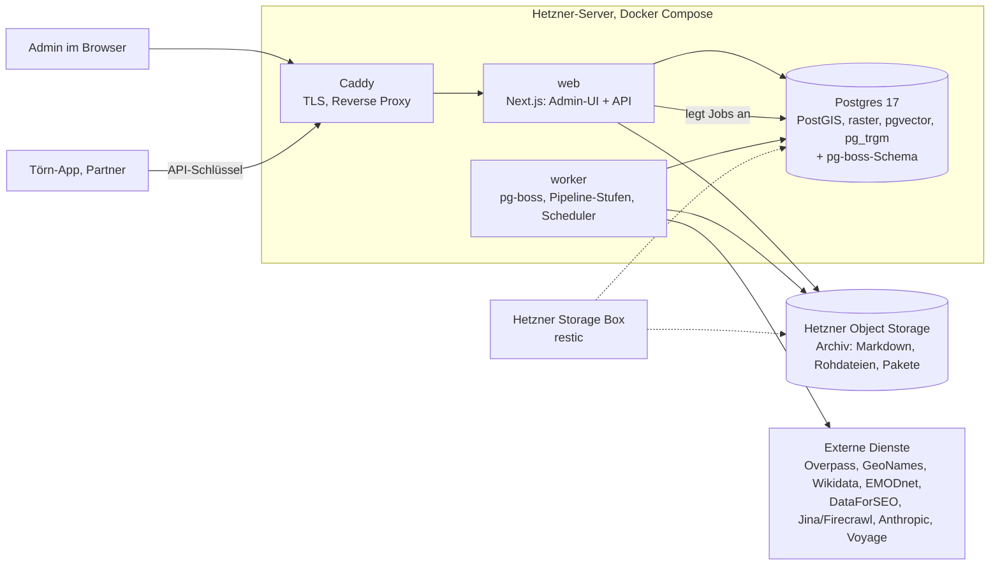

# Periplus – Gesamtdesign und Roadmap

Stand: 18.10.2026 · Status: Entwurf zur Freigabe · Fachliche Grundlage: `.idea/datendienst-spec.md` (im Folgenden „Quell-Spec“; sie ist maßgebend)

Periplus ist der Ankerplatz-Datendienst aus der Quell-Spec: ein eigenständiger Dienst, der Wissen über Ankerplätze, Häfen, Marinas, Reviere und Routen im Mittelmeer sammelt, belegt, auf einer Zeitachse versioniert und über eine API bereitstellt. Der Name kommt vom antiken Periplus, dem Verzeichnis der Häfen und Landmarken entlang einer Küste.

Dieses Dokument legt fest, **wie** Periplus gebaut wird, und verweist für das **Was** auf die Quell-Spec. Bei jedem Widerspruch gilt die Quell-Spec; die einzigen Abweichungen stehen in Abschnitt 4 und gehen auf Entscheidungen von Christian zurück oder lösen einen Widerspruch innerhalb der Quell-Spec auf. Die Teil-Specs wiederholen die Quell-Spec nicht, sondern verweisen auf ihre Abschnitte und ergänzen, was für die Umsetzung fehlt. Die Teil-Specs unter `docs/superpowers/specs/2026-10-18-periplus-NN-*.md` vertiefen je einen Bereich; jede ist so geschrieben, dass sich daraus ein Implementierungsplan ableiten lässt.

## 1. Zweck und Warum

Eine Törnplanung ist nur so gut wie ihre Ortsdaten. Die verfügbaren Daten (Navily, Revierführer, Foren) sind entweder lizenzrechtlich nicht nutzbar, unvollständig, nicht maschinenlesbar oder ohne Zeitbezug. Periplus baut eine eigene, belegte Wissensbasis aus offenen Daten, Berechnung und öffentlichen Texten, die

- für jeden Ort rechenbare Werte liefert (Schutz je Windsektor, Tiefe, Grund, Ausschlüsse),
- jeden Wert mit Herkunft und Konfidenz versieht,
- nie überschreibt, sondern versioniert („Wie sah die Bucht im Juni 2025 aus?“),
- ohne Zutun weiterläuft und Änderungen meldet.

Abnehmer ist eine Törn-App (der Prototyp DSTAP war der erste Versuch; die nächste App wird neu gebaut) und später Partner. Periplus kennt keinen Abnehmer im Detail: es liefert einen eigenen, versionierten Vertrag (Teil-Spec 08).

## 2. Ziele, Nicht-Ziele, Anti-Ziele

**Ziele**

1. Pilot Saronischer und Argolischer Golf mit den Zielwerten der Quell-Spec (Abschnitt „Qualitätsmetriken“), aber von Anfang an als laufender Dienst mit Weboberfläche statt als Skriptsammlung.
2. Danach Betrieb ohne Zutun: Zyklen je Kachel, Change-Feed, Review nur an den vier Rändern der Quell-Spec.
3. Ausbau auf weitere Landesteile ohne Umbau: ein neuer Landesteil ist Konfiguration und Laufzeit, kein Code.

**Nicht-Ziele**

- Routenplanung, Wetter, Polardiagramme, Schlagberechnung (gehört in die Törn-App).
- Endnutzer-Oberfläche. Die Weboberfläche ist ein internes Werkzeug zum Prüfen, Entscheiden und Beobachten.
- Kompatibilität mit dem Datenmodell von DSTAP (Navily-IDs, `berths.json`, Overrides).
- Mandanten, Rollen, Organisationen. Es gibt Admins und API-Clients.

**Anti-Ziele** (wäre ein Fehlschlag, auch wenn es technisch läuft)

- Ein Fact ohne wörtlichen Beleg oder Berechnungs-Eingangsdaten in der Datenbank.
- Fremde Inhalte (Navily-Daten, Google-Inhalte, Textpassagen Dritter) in Lieferungen.
- Ein Review-Aufwand, der mit der Zahl der Orte linear wächst, statt nach zwei Läufen zu sinken.
- Ein Lauf, dessen Kosten man nicht je Kachel und Stufe beziffern kann.
- Eine Änderung, die einen alten Stand unlesbar macht.

## 3. Grundprinzipien

Es gelten die elf Grundprinzipien der Quell-Spec unverändert. Zusätzlich für die Umsetzung:

1. **Schlank.** Periplus ist ein Datensammel- und Bereitstellungsdienst. Es übernimmt von anderen Projekten nur, was hier trägt (Proxy mit Default-Deny, Fachlogik in `lib/domain`, Tests gegen echte Datenbank), nicht deren Infrastruktur (Entra, Repo-Vorlage, GlitchTip, gemeinsamer App-Server).
2. **Jobs von Anfang an.** Jede Pipeline-Stufe ist ab dem ersten Meilenstein ein Job in einer Queue, auch im Pilot. Das ersetzt die Pilot-Skripte der Quell-Spec und erspart den späteren Umbau.
3. **Konfiguration statt Code** für alles, was die Quell-Spec als Konfiguration nennt: Fact-Schema, Kategorie-Zuordnungen, Konsolidierungsparameter, Budgets, Prompts, Zyklen.
4. **Externe Dienste hinter Adaptern**, jeder mit Aufzeichnung (Fixture) für Tests. Kein Test ruft das Netz.

## 4. Abweichungen von der Quell-Spec

| Quell-Spec | Periplus | Grund |
| --- | --- | --- |
| Pilot als Skripte, Postgres und Review-Notebook; Scheduler, Queue, API, Admin-UI erst danach | Queue, Worker, Admin-UI und Liefer-API ab Meilenstein 0; nur der **automatische** Scheduler und der volle REST-Endpunktsatz kommen nach dem Pilot | Entscheidung Christian: vollständiger Dienst mit Weboberfläche |
| Teil B: Vertrag mit Zuordnung zum DSTAP-Modell, `legacyIdMap`, Ersatz von DSTAP-Dateien | Eigener, abnehmerneutraler Vertrag „Periplus Data Contract v1“ (Teil-Spec 08); Grundregeln und Feldsemantik aus Teil B bleiben, DSTAP-spezifische Teile entfallen | Entscheidung Christian: DSTAP war Prototyp, keine Kompatibilität nötig |
| Admin-UI im Stack von Caloga/Contexta | Next.js 16 wie dort, aber ohne Entra/Auth.js; eigene schlanke Admin-Anmeldung | Entscheidung Christian |
| Betrieb „wie die anderen Designery-Dienste“ | Eigener Hetzner-Server, Docker Compose | Entscheidung Christian (Hetzner); Docker Compose ist Entscheidung Claude (PostGIS, pgvector und Raster-Unterstützung stecken so im Image) |
| Arbeitsname „Datendienst“ | Periplus | Entscheidung Christian |
| Ort-Highlights nur als Facts je Kategorie (Teil A) vs. eigene Highlight-Objekte (Teil B) | Beides: ein Highlight ist ein Geo-Objekt vom Typ `poi` mit Kategorie und eigenen Facts; die Kategorie-Facts am Ort werden daraus abgeleitet | Entscheidung Claude, löst den Widerspruch zwischen Teil A und B |
| Revier als Ebene der Hierarchie (Meer → Revier → Insel → Ort) und als Liefereinheit | Reviere sind überlappende Namensgebiete außerhalb der Hierarchie; Hierarchie und Lieferumfang laufen über Landesteile (Land, Verwaltungseinheit) | Entscheidung Christian: Reviere überlappen in der Welt; Landesteile sind eindeutig und lückenlos (Teil-Spec 14) |
| Kacheln ohne Revier → Review „Küstenkachel ohne Revier“ | Jede Küstenkachel liegt in einem Landesteil; ausgeschlossene Landesteile statt Einzelentscheidungen | Folge der Landesteile (Teil-Spec 14) |
| Nach außen nur abgeleitete Fakten (Teil A, Rechtliches) | Zusätzlich liefert der Vertrag ein Titelbild je Spot: ein aus Luftbildern abgeleitetes, KI-bearbeitetes Bild (kein Fakt) mit Kamera, Licht, Namensnennung und Aufnahmedatum. Zulässig, weil die Luftbilder unter offenen oder dafür erworbenen Lizenzen stehen; ausgeliefert wird eine Quelle erst, wenn ihr Liefer-Schalter in `config/images.json` auf `true` steht (Kataster: nach schriftlicher Bestätigung) | Entscheidung Christian, 20.10.2026 (Teil-Spec 13) |
| Highlight zählt für alle Spots in seinem Bedeutungsradius (5–50 sm je Wichtigkeit) | Highlight zählt für die Orte, bei denen es unter den fünf wichtigsten seiner Kategorie in Reichweite (1–20 km Landweg) ist | Entscheidung Christian: höchstens fünf je Kategorie; „dort“ heißt an Land erreichbar (Teil-Spec 16) |
| Highlights je Kategorie als Fact „vorhanden, Anzahl, …“ | „Anzahl“ wird zur Stufe `none`/`some`/`many` | Entscheidung Christian: Einschätzung statt Zählung (Teil-Spec 16) |

## 5. Architektur



- **web** und **worker** sind dasselbe Repo, dieselbe Codebasis (`lib/`), zwei Einstiegspunkte: Next.js-Server und `worker/index.ts`. Der Worker ist zustandslos und skaliert über die Zahl der Container bzw. Nebenläufigkeit je Queue.
- **Die Web-App führt nie Pipeline-Arbeit aus**; sie legt Jobs an (z. B. „Lauf für Kachel starten“) und liest Ergebnisse.
- **Abnehmer kennen nur die API** unter `/api/v2` (Vertrag 2.0, Teil-Spec 14; `/api/v1` nur noch für die Schemas von 1.0), nie die Datenbank.

## 6. Technische Entscheidungen

Alle Einträge sind Entscheidungen Claude, sofern nicht anders markiert; jede ist mit Grund versehen, damit sie sich begründet ändern lässt.

| Baustein | Entscheidung | Grund |
| --- | --- | --- |
| Sprache, Laufzeit | TypeScript, Node 22 LTS | Ein Stack für UI, API, Worker; Gerüst steht bereits |
| Web | Next.js 16 (App Router), React 19, Tailwind 4 (vorhanden) | Entscheidung Christian (Stack wie Caloga) |
| Datenbankzugriff | **Drizzle ORM** + drizzle-kit Migrationen; rohes SQL für PostGIS/Raster/Vektor-Abfragen über `sql\`\`` | Periplus ist geometrie- und SQL-lastig; Drizzle hat Geometrie- und Vektor-Spaltentypen und bleibt nah am SQL. Prisma (Caloga) behandelt Geometrie nur als `Unsupported` |
| Datenbank | PostgreSQL 17 mit PostGIS 3.6 (inkl. `postgis_raster`), pgvector, pg_trgm, unaccent | Quell-Spec; Raster für Bathymetrie direkt in der DB |
| Queue | pg-boss in derselben Datenbank | Quell-Spec nennt es; kein separater Broker, Jobs transaktional neben den Daten |
| Objektspeicher | Produktion: Hetzner Object Storage; Entwicklung: SeaweedFS im Compose; Zugriff nur über die S3-API (`@aws-sdk/client-s3`) | Verwaltet, kein eigener Speicherdienst auf dem Server; MinIO veröffentlicht keine freien Images mehr |
| Validierung | zod 4; JSON-Schemas des Liefervertrags werden aus zod erzeugt | Eine Quelle für Laufzeitprüfung und veröffentlichtes Schema |
| KI | Anthropic SDK, Message Batches API für Klassifikation und Extraktion; strukturierte Ausgabe über JSON-Schema | Quell-Spec; Modell-IDs und Prompt-Versionen in Konfiguration |
| Embeddings | Voyage AI (mehrsprachiges Modell) hinter Adapter, Dimension aus Konfiguration | Anthropic bietet keine Embeddings; Quellen sind fünfsprachig |
| Karte in der UI | MapLibre GL JS mit OpenFreeMap-Basiskarte | Frei, ohne Schlüssel, Vektor-Overlays aus eigener API (GeoJSON) |
| Logging | pino, strukturiert, `traceId` je Anfrage/Job | Bewährt in Caloga/Contexta; Fehlerdienst (GlitchTip o. ä.) bewusst erst bei Bedarf |
| Tests | Vitest gegen echte Postgres (Compose-Dienst `db-test`), Fixtures für externe Dienste, `MockModel` für KI; Playwright nur für wenige Kernabläufe der UI | Geometrie und Zeitachse lassen sich nur gegen echtes PostGIS prüfen |
| Anmeldung UI | Admin-Konten in Tabelle `users` (argon2id), Sitzung als signiertes httpOnly-Cookie (jose), Anlage per CLI | Entscheidung Christian: ohne Microsoft; ein bis drei Admins brauchen keinen Identitätsanbieter |
| Anmeldung API | API-Schlüssel je Client, nur SHA-256-Hash gespeichert, Scopes, Rate-Limit | Wie Quell-Spec (Partner mit eigenem Schlüssel) |
| Hosting | Hetzner Cloud, ein Server, Docker Compose (caddy, web, worker, postgres) plus Hetzner Object Storage, Images aus GitHub Actions in GHCR | Entscheidung Christian (Hetzner); Compose-Aufbau Claude |
| Repo | GitHub `Crilabs/periplus` (Annahme, wie DSTAP) | Lässt sich ohne Folgen ändern |

Ausdrücklich **nicht** übernommen: Repo-Vorlage, Codacy, Renovate-Tiers, SITA-Devlog, Entra, `service.yaml`, pm2-Release-Mechanik.

## 7. Code-Struktur

```
app/                      Next.js: Admin-UI (app/(admin)/…), Login, API (app/api/v2/…), Health
lib/
  db/                     Drizzle-Schema (schema/*.ts), Client, SQL-Helfer für PostGIS
  domain/                 Fachregeln: gazetteer, tiles, places, sources, documents, mentions,
                          facts, consolidation, changes, delivery, review, quality
  pipeline/               Ein Modul je Stufe (gazetteer, seed, geometry, discovery, fetch,
                          mentions, extraction, consolidation) + runs.ts (Läufe, Kosten)
  adapters/               overpass, geonames, wikidata, nominatim, emodnet, dataforseo,
                          fetch (jina, firecrawl, playwright), pdf, anthropic, voyage, s3
  ai/                     Modell-Abstraktion: Prompt-Laden, Versionierung, Batch, Kosten
  api/                    Handler-Hülle, Fehlerabbildung, Serialisierung des Vertrags
  security/               proxy-Entscheidung, Sitzung, API-Schlüssel
  config/                 Laden und Validieren von config/*
  logger.ts
worker/index.ts           Einstieg Worker: registriert alle Queues, Scheduler
config/                   Versionierte Konfiguration (Fact-Schema, Kategorien, Regeln, Budgets,
                          Prompts, Reviere, Zyklen)
contract/                 Liefervertrag: zod-Schemas, erzeugte JSON-Schemas je Version
scripts/                  CLI: user:create, apikey:create, import:bathymetry, …
test/                     Testhelfer, Fixtures externer Dienste
docker/                   Dockerfiles (web, worker, postgres), Caddyfile, compose-Dateien
docs/                     Quell-Spec, Specs, Pläne, Runbook
```

Regeln: Fachlogik nur in `lib/domain` und `lib/pipeline`; Seiten, API-Routen und Job-Handler sind dünn. Kein Import von `lib/db` aus Client-Komponenten.

## 8. Konventionen

- **Sprache:** Code, Bezeichner, Enum-Werte, Tabellen, API und Vertrag englisch; Oberfläche deutsch; Specs deutsch.
- **Glossar** (ein Begriff, einmal übersetzt):

| Fachbegriff (Spec) | Code | Anmerkung |
| --- | --- | --- |
| Geo-Objekt | `GeoObject` | Gazetteer-Eintrag jeder Ebene |
| Landesteil | `subdivision` (Tabelle; Geo-Objekte `country`, `admin_region`) | Land oder Verwaltungseinheit erster Ebene mit Mittelmeerküste; Laufumfang, Elternobjekt und Liefereinheit des Vertrags (Teil-Spec 14) |
| Revier | `area` (Geo-Objekt-Typ; Tabellen `area_members`, `area_evidence`) | Überlappendes Namensgebiet eines Seegebiets außerhalb der Hierarchie; geliefert vom Revier-Bot als Datei je Land und importiert (`config/area-imports/`), Mitglieder und Belege in `area_members` und `area_evidence`; im Manifest nur zur Information (Teil-Spec 14) |
| Kachel | `Tile` | |
| Ort | `Place` | Liegeplatz: Ankerplatz, Hafen, Marina, Bojenfeld |
| Highlight | `GeoObject` Typ `poi` mit `category` | |
| Quelle | `Source` | Domain oder Datensatz |
| Dokument / Dokumentversion | `Document` / `DocumentVersion` | |
| Erwähnung | `Mention` | |
| Fact | `Fact` | |
| Berechnung | `Computation` | Beleg berechneter Facts |
| Beobachtung | `Observation` | |
| Ortsprofil | `Profile` | je Geo-Objekt, versioniert |
| Änderungsereignis | `ChangeEvent` | |
| Lauf | `Run` | Ein Pipeline-Durchlauf für Kachel/Block |
| Review-Aufgabe | `ReviewTask` | |
| Vergleichssatz | `ComparisonSet` | Navily-Abgleich, nur Ergebnisse |
| Lieferung / Paket | `Delivery` | |

- **IDs:** intern UUIDv7 (zeitlich sortierbar). Öffentliche, stabile IDs mit Präfix (`sp_`, `hl_`, `rg_`, `ar_`, `sd_` für Landesteile) + ULID, einmal vergeben, nie wiederverwendet.
- **Zeit:** alle Zeitstempel `timestamptz` UTC; fachliche Daten (`observed_at`, `valid_from`) als `date`.
- **Koordinaten:** WGS84, PostGIS `geography`/`geometry(…, 4326)`; Distanzen intern Meter, im Vertrag Seemeilen.

## 9. Querschnittsthemen

- **Zeitachse:** Tabellen sind entweder *stabil mit Gültigkeit* (`valid_from`, `valid_to`) oder *nur anfügend*. Nur anfügende Tabellen werden per Datenbank-Trigger gegen `UPDATE` (außer ausgewiesenen technischen Feldern) und `DELETE` geschützt. Details Teil-Spec 02.
- **Idempotenz:** jeder Job hat einen fachlichen Schlüssel (Dokument über Hash, Fact über (Erwähnung, Attribut, Extraktionslauf)); Wiederanlauf erzeugt keine Dubletten.
- **Kosten:** jeder externe Aufruf schreibt eine Zeile in `external_calls` (Dienst, Einheit, Menge, Kosten in EUR, Lauf, Kachel, Stufe). Tagesbudgets je Dienst in `config/budgets.json`; bei Erreichen pausiert nur die betroffene Queue.
- **Modell-Schnittstelle:** jeder KI-Aufruf trägt Prompt-ID + Version, Modell, Schema-Version; jeder Fact weiß, womit er entstand.
- **Rechtliches:** robots.txt, Rate-Limits, User-Agent mit Kontakt; Archiv intern; nach außen nur abgeleitete Fakten; OSM-Attribution (ODbL) im Manifest und in der UI.

## 10. Roadmap

Jeder Meilenstein endet mit etwas, das man in der Oberfläche sieht, und einer Abnahme. Die Wochenangaben sind Richtwerte für eine Person mit Claude; die Pilot-Zeitleiste der Quell-Spec (vier Wochen) verschiebt sich um den Fundament-Meilenstein und die UI-Anteile.

| M | Name | Ergebnis | Teil-Specs | Abnahme |
| --- | --- | --- | --- | --- |
| **M0** | Fundament | Repo, Compose lokal und auf dem Server, DB mit allen Erweiterungen, Drizzle-Schema-Grundlage, Admin-Login, Proxy, Worker mit pg-boss, S3, Kosten-Ledger, Modell-Adapter-Gerüst, CI und Deploy, Admin-Shell mit leerer Karte | 01, 02 (Grundtabellen), 09 (Shell) | Login auf dem Server; ein Test-Job läuft durch und erscheint in der Job-Übersicht; `/readyz` grün; Backup einmal wiederhergestellt |
| **M1** | Gazetteer und Kacheln | Stufen 1 und 2 für das Pilotgebiet: Raster, Geo-Objekte mit Hierarchie und Namen, Reviere „Saronischer Golf“ und „Argolischer Golf“, Ortskandidaten, Review „Ortskandidat“ und „Küstenkachel ohne Revier“, Vergleichssatz (50 Orte) erfassbar | 02, 03, 09, 10 | Karte zeigt Kacheln, Hierarchie, Kandidaten; jede Insel, jeder Küstenort, jede benannte Bucht mit Namen de/en/el |
| **M2** | Geometrie und Ausschlüsse | Stufe 3: Schutz je Sektor, Fetch, Tiefe, Grund, Ankerfläche, erste Ankerposition; amtliche Ausschlussflächen (EMODnet Human Activities) | 04 | Jeder Kandidat hat 8 Sektorwerte mit Beleg; Stichprobe gegen Vergleichssatz dokumentiert |
| **M3** | Quellen und Archiv | Stufen 4 und 5: SERP auf Revier- und Kachelebene, Linkgraph, Quellen-Review, Crawler mit Regeln, Konverter-Vergleich an 50 Seiten, PDF an zwei Revierführern, Chunks und Embeddings, Dokument-Viewer mit Versionen | 05, 09 | Whitelist mit 20–40 Quellen; voller Crawl archiviert; Entscheidung Konverter dokumentiert |
| **M4** | Erwähnungen und Facts | Stufen 6 und 7: Trigram-Match, Disambiguierung, Extraktion mit Belegzitat, Modellvergleich an 200 Erwähnungen, Routen aus Törnberichten | 06, 09 | Belegtreue 100 %; Modellwahl dokumentiert; Facts mit hervorgehobenem Zitat in der UI |
| **M5** | Konsolidierung und Änderungen | Stufe 8: Profile mit Regeln je Attribut, Konflikte, Lückenliste, Änderungsereignisse, Profil zum Datum | 07, 09 | Profil jedes Orts in der UI mit Herkunft je Attribut; Zeitregler zeigt alten Stand |
| **M6** | Lieferung | Liefervertrag v1: Paketbau, Validierung, Archiv der Pakete, API für Pakete, Profile mit `asOf`, Changes | 08 | Paket des Pilotreviers besteht alle Validierungsregeln; per API mit Schlüssel abrufbar |
| **M7** | Pilot-Abnahme | Qualitätsdashboard, Navily-Abgleich, Routen-Rekonstruktion an 3 Törnberichten, simulierter Revisit, Kostenbericht und Mittelmeer-Hochrechnung | 10 | Erfolgskriterien der Quell-Spec (Abschnitt „Pilot“) erfüllt |
| **M8** | Dauerbetrieb | Automatischer Scheduler mit Zyklen je Kachel, täglicher Fetch, wöchentliche Konsolidierung, voller REST-Endpunktsatz, `POST /reports`, Monitoring mit Alarmen, Rückfluss der Review-Entscheidungen | 01, 05, 07, 08, 09 | Zwei Wochen ohne Eingriff außer Review; Alarm getestet |
| **M9** | Ausbau | Landesteil für Landesteil über das Mittelmeer („Länder und Landesteile“, Teil-Spec 14), NAVTEX-Dauerverbote, Fährkorridore, Partner-Schlüssel, Beobachtungen aus der App, YouTube-Transkripte | alle, 14 | Je neuer Landesteil ohne Codeänderung |

**Gates:** M7 ist das Gate zum Dauerbetrieb (Quell-Spec: „Service-Rahmen wird gebaut, sobald der Pilot die Zielwerte erreicht“). Verfehlt der Pilot einen Zielwert, wird vor M8 nachgebessert, nicht ausgebaut.

**Parallelisierbar:** M2 (Geometrie) und M3 (Quellen) hängen beide nur an M1 und können parallel laufen.

## 11. Teil-Specs

| Nr. | Datei | Inhalt |
| --- | --- | --- |
| 01 | `2026-10-18-periplus-01-fundament-design.md` | Repo, Compose, Server, CI/CD, Anmeldung, Proxy, Worker, Queue, Kosten und Budgets, Modell-Adapter, Logging, Backups |
| 02 | `2026-10-18-periplus-02-datenmodell-design.md` | Tabellen, Zeitachse, IDs, Fact-Schema als Konfiguration |
| 03 | `2026-10-18-periplus-03-gazetteer-design.md` | Stufen 1 und 2: Raster, Gazetteer, Reviere, Seed |
| 04 | `2026-10-18-periplus-04-geometrie-design.md` | Stufe 3: Schutz, Fetch, Tiefe, Grund, Ausschlussflächen |
| 05 | `2026-10-18-periplus-05-quellen-archiv-design.md` | Stufen 4 und 5: Quellenfindung, Crawl, Konvertierung, Archiv, Chunks |
| 06 | `2026-10-18-periplus-06-erwaehnungen-facts-design.md` | Stufen 6 und 7: Erwähnungen, Disambiguierung, Fact-Extraktion, Routen |
| 07 | `2026-10-18-periplus-07-konsolidierung-design.md` | Stufe 8: Profile, Regeln, Konflikte, Änderungserkennung |
| 08 | `2026-10-18-periplus-08-liefervertrag-api-design.md` | Periplus Data Contract v1, Paket, API, Change-Feed |
| 09 | `2026-10-18-periplus-09-admin-ui-design.md` | Admin-Oberfläche: Seiten, Review, Karte, Dashboard |
| 10 | `2026-10-18-periplus-10-qualitaet-pilot-design.md` | Kennzahlen, Vergleichssatz, Revisit-Simulation, Pilot-Abnahme |
| 11 | `2026-10-19-periplus-11-quellen-autofreigabe-design.md` | Automatische Quellenfreigabe mit Schattenbetrieb und Probezeit; zurückgestellt bis zu einem Auslöser aus Phase 0 |
| 12 | `2026-10-20-periplus-12-pruefung-echtdaten-design.md` | Schrittweise Prüfung mit echten Daten (Probekachel → Revier) nach M7 Teil (a), vor dem vollen Pilotlauf |
| 13 | `2026-10-20-periplus-13-ortsbilder-design.md` | Ortsbilder (Plan `docs/superpowers/plans/2026-10-20-periplus-13-ortsbilder.md`): Luftbild auf Gelände als 30°-Schrägansicht vom Wasser rendern, mit Bildmodell zum Katalogbild machen (Ankerbuchten mittags, Häfen und Orte bei Städten abends), Prüfung und Freigabe, Feld `image` im Vertrag; Fotos und Aussehens-Merkmale als zweite Stufe; erste Umsetzung nur Griechenland mit freien Daten (Kataster-Orthofoto, Sentinel-2, Copernicus DEM); nach M7 |
| 14 | `2026-10-20-periplus-14-raumgliederung-design.md` | Raumgliederung: Landesteile (Land, Verwaltungseinheit) als Laufumfang, Hierarchie und Liefereinheit (Vertrag 2.0), Grob-Gazetteer, Ansicht „Länder und Landesteile“; Reviere als überlappende Namensgebiete, vom Revier-Bot geliefert und importiert (Plan 14a und 14b); umgesetzt |
| 15 | `2026-10-21-periplus-15-marina-services-design.md` | Marina-Services: Diesel und Wasser nur, wenn die Marina sie selbst anbietet, gezielt von ihrer eigenen Website gelesen; Highlight-Kategorien nur noch für die Törnplanung; Fact-Schema v3; umgesetzt zusammen mit 17 |
| 16 | `2026-10-21-periplus-16-highlights-design.md` | Highlights je Ort: höchstens fünf je Kategorie, Wichtigkeit 1–5 über Orte vergleichbar, Stufe „nur das / einiges mehr / sehr viel mehr“, Reichweite nach Wichtigkeit; umgesetzt |
| 17 | `2026-10-22-periplus-17-festmachplatz-auslieferung-design.md` | Ortsarten (Marina, Ankerplatz, Bojenfeld, Hafen), Festmachplatz `berthable`, Bestätigung und Auslieferung nach Beleg ohne Mensch, `contact` im Vertrag (2.3); umgesetzt zusammen mit 15 |
| 18 | `2026-10-23-periplus-18-umkreis-lieferung-design.md` | Lieferung nach Umkreis um eine Heimatmarina für die Offline-Nutzung an Bord (Radius 50 sm × Tage / 2), zusammengesetzt aus den gültigen Landesteil-Paketen, Lücken im Manifest, Änderungen je Landesteil-Version; `popularity` mit fester Nachbarschaft von 50 sm; Vertrag 3.0, `/api/v3` |
| 16 | `2026-10-21-periplus-16-highlights-design.md` | Highlights je Ort (Plan `docs/superpowers/plans/2026-10-21-periplus-16-highlights.md`): höchstens fünf je Kategorie, Wichtigkeit 1–5, Reichweite, Stufen `none`/`some`/`many`, Stufe `consolidation.highlights`, Vertrag 2.2 `spot.highlightLevels` |

## 12. Offene Punkte

Aus der Quell-Spec weiter offen (werden im genannten Meilenstein entschieden): Fetch-Konverter (M3), Modellklasse Extraktion (M4), Kachelgröße (nach M5, aus Ortszahl je Kachel), Kachelgrenzen (M4), Bilder und Karten in Quellen (nach M7, Bilder: Teil-Spec 13), YouTube (M9), Revierführer-Vereinbarungen (vor M8), Nutzer-Meldungen als Quelle (M8), ODbL-Trennung (vor M6, siehe Teil-Spec 08). Erledigt: Revier-Polygone (durch Teil-Spec 14: Reviere werden gefunden, Landesteile tragen Umfang und Lieferung).

Neu offen:

- Domain für Periplus (z. B. `periplus.<domain>`); bis dahin die Hetzner-IP mit Caddy-internem Zertifikat.
- Servergröße: Startvorschlag 8 vCPU / 16 GB / 160 GB SSD (Hetzner CCX23 oder CPX41-Klasse), nach M3 messen.
- Ob Admin-Konten mit zweitem Faktor (TOTP) abgesichert werden; Vorschlag: ja ab M8, wenn die API öffentlich Partner bedient.

Entschieden in diesem Dokument und in den Teil-Specs (als Entscheidung Claude markiert): alle Zeilen der Tabelle in Abschnitt 6 ohne Vermerk, Highlights als `poi`-Geo-Objekte, Schutz intern als Zahl 0–1, Paket- und API-Form des Vertrags.

## 13. Was dem Builder überlassen ist

Tabellennamen im Detail, Indexwahl, Bibliotheken unterhalb der genannten Bausteine (z. B. HTML-zu-Markdown-Konverter im eigenen Crawler, ULID-Bibliothek), UI-Gestaltung innerhalb der Seitenliste von Teil-Spec 09, Aufteilung in Pläne und PRs. Vor Code an Routen, `proxy.ts` oder `next.config.ts` die Next-16-Doku unter `node_modules/next/dist/docs/` lesen (siehe `AGENTS.md`).
