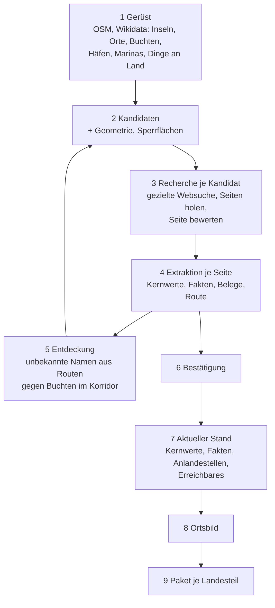

# Periplus – Neuausrichtung: vom Liegeplatz aus

Stand: 23.10.2026 · Status: Entwurf zur Freigabe · Ersetzt in den unten genannten Punkten die Quell-Spec (`.idea/datendienst-spec.md`), das Gesamtdesign (`2026-10-18-periplus-design.md`) und die Teil-Specs 03, 05–08, 10, 11, 16 und 17; Spec 18 (Umkreis-Lieferung) bleibt gültig

## 1. Warum

Periplus ist das wichtigste Asset des Unternehmens. Der bisherige Aufbau geht von den **Quellen** aus: Domains finden und freigeben, ganze Websites crawlen, in jedem Text jedes bekannte Geo-Objekt suchen, Mehrdeutigkeiten klären, Facts ziehen, versioniert konsolidieren. Die Dev-Datenbank zeigt, wohin das führt (Stand 23.10.2026):

| Messgröße | Wert |
| --- | --- |
| Erwähnungen | 28.782, davon ~6 % an Buchten und Häfen |
| mehrdeutige Treffer / Text-Schnipsel für den Abgleich | 75.461 / 2,06 Mio. |
| Quellen vorgeschlagen / abgelehnt / freigegeben | 549 / 461 / 27 |
| Facts | 4.533, davon 83 % an Buchten und Häfen |
| bestätigte Liegeplätze | 10 |

Der Nutzen entsteht fast nur bei den Liegeplätzen, der Aufwand überall. Dazu kommen Zeitachse, Rücknahmen und Change-Feed, die niemand braucht, und ein Fact-Schema, das gerade das Wertvollste ausschließt: die Erfahrung („traumhafter Strand“, „bequeme Liegestühle“).

Die Neuausrichtung dreht den Ansatz um: **Der Liegeplatz ist der Mittelpunkt.** Recherche, Fakten und Umgebung werden von ihm aus gedacht.

## 2. Was Periplus ist

Ein Datendienst, der für eine Törn-App (später Partner) je **Liegeplatz** liefert:

1. **Ob man dort sicher liegen kann**: nur bestätigte Liegeplätze werden geliefert.
2. **Kernwerte des Liegeplatzes**: Schutz je Wind, Grund, Halt, Tiefe, Gebühren, Bojen (öffentlich nutzbar?), Verbote, Saison und Belegung.
3. **Fakten**: einzelne, freie Aussagen über den Liegeplatz und seine Umgebung an Land, in eigenen Worten, mit Beobachtungsdatum („Bäcker im Dorf öffnet um 7 Uhr“, „nachts Fallböen von Westen“, „sehr bequeme Liegestühle am Strand“).
4. **Was an Land erreichbar ist**: Strände, Orte, Tavernen, Läden, Sehenswertes, Bus und Taxi, jeweils mit Lage und Erreichbarkeit von der Anlandestelle.
5. **Ein Ortsbild** (Teil-Spec 13).

Liegeplatz heißt: Ankerplatz, Bojenfeld, Marina, Hafen (mit Gastplätzen).

Periplus erzeugt **keine Texte** für Endnutzer; die App generiert sie aus den Fakten. Periplus liefert **keine Quellen**: Quellen, Zitate und das Archiv bleiben intern.

## 3. Ziele, Nicht-Ziele, Anti-Ziele

**Ziele**

1. Griechenland Anfang November 2026, das ganze Mittelmeer bis Februar 2027 (Christian). Qualität geht vor Termin (Christian); „Anfang November“ ist ein Ziel, kein fester Termin. „Griechenland steht“ heißt: Paket im Vertrag 4.0 für alle griechischen Landesteile, nach bestandenem Probelauf (Abschnitt 9). Das Neue wird neben dem Alten gebaut, die alten Textstufen werden nicht mehr gestartet und am Ende in einem Zug entfernt (Entscheidung Claude: Facts hängen per Fremdschlüssel an Erwähnungen, Konsolidierung, Bilder und Lieferung an Facts und Profilen; ein Rückbau zuerst ließe das System ohne lauffähigen Stand und ohne Tests als Netz).
2. Ein sauberes, schlankes System: was dem alten Ansatz diente, wird entfernt, nicht abgeschaltet mitgeschleppt (Christian).
3. Qualität vor Kosten: Recherche darf je Liegeplatz kosten, was die Treffsicherheit erhöht; Maßstab ist der Einkaufspreis lizenzierter Daten wie Navily (Christian). Kosten bleiben je Kandidat und Stufe sichtbar; das Budget in `config/budgets.json` ist Notbremse gegen Fehler, keine Sparvorgabe. Ohne menschliche Freigabe im Dauerbetrieb.
4. Ein neuer Landesteil ist Konfiguration und Laufzeit, kein Code (bleibt aus dem Gesamtdesign).

**Nicht-Ziele**

- Zeitachse: keine Profilversionen, kein „Stand zum Datum“, kein Change-Feed (Christian: „aktueller Stand reicht“).
- Texte für Endnutzer, Zusammenfassungen (Christian: macht die App).
- Quellenangaben in der Lieferung (Christian).
- Breiter Crawl ganzer Websites, Quellenfreigabe als eigener Schritt.
- Dinge an Land, die von keinem Liegeplatz erreichbar sind (Christian: „ein Strand, wo ich nicht ankern kann, ist irrelevant“).
- Routenplanung, Wetter (wie bisher).

**Anti-Ziele** (Fehlschlag, auch wenn es technisch läuft)

- **Ein ausgelieferter Liegeplatz, an dem man nicht ankern oder festmachen kann.** Eine Crew fährt abends dorthin, es wird dunkel, es beginnt eine Notlage. Dafür trägt Periplus Verantwortung (Christian).
- Ein Fakt in der Datenbank ohne wörtliches Zitat oder Berechnungs-Eingangsdaten.
- Fremde Formulierungen, Quellennamen oder Links in der Lieferung.
- Aufwand, der mit der Größe des Gazetteers wächst statt mit der Zahl der Liegeplätze.
- Ein Ablauf, der Sicherheit von einer menschlichen Freigabe abhängig macht: der Mensch weiß es auch nicht besser (Christian). Sicherheit entsteht aus den Regeln und dem Navily-Test.

## 4. Grundsätze

1. **Sicherheit zuerst.** Geliefert wird nur ein *bestätigter* Liegeplatz (Abschnitt 6). Im Zweifel nicht liefern. Ein fehlender Platz ist ärgerlich, ein falscher gefährlich (Christian).
2. **Geographie schlägt vor, Berichte bestätigen.** OSM und Geometrie liefern präzise Lage und Kandidaten, bestätigen aber nie allein. Berichte liefern die Bestätigung und die Erfahrung, aber unscharfe Lage. Texte wählen aus den geographisch möglichen Orten, sie erfinden keine Koordinaten.
3. **Negativbelege wiegen schwerer als positive.** Ein jüngeres Verbot, „Bojen jetzt privat“, „Fischzucht“ sperrt oder geht an einen Menschen.
4. **Recherche vom Liegeplatz aus.** Gesucht wird gezielt nach einem Liegeplatz; die Zuordnung ist durch die Suche weitgehend erledigt. Kein Abgleich „alle Texte × alle Namen“.
5. **Text immer aus Sicht eines Liegeplatzes.** Eine Erfahrung zählt, weil jemand dort lag und davon berichtet, auch wenn sie sich auf etwas an Land bezieht (Christian).
6. **Kein Fakt ohne Beleg.** Jeder Fakt trägt intern Quelle, wörtliches Zitat (geprüft) und Beobachtungsdatum. Geliefert wird nur die Aussage in eigenen Worten.
7. **Aktueller Stand.** Was gilt, gilt jetzt. Falsches wird korrigiert oder gelöscht. Das Beobachtungsdatum bleibt am Fakt, damit Aktualität bewertet werden kann.
8. **Unsicher heißt nicht geliefert.** Was die KI nicht sicher bestätigen kann, bleibt Kandidat; es wird keine Review-Aufgabe. Ein Mensch entscheidet nur Konflikte mit der Navily-Referenz im Test (Abschnitt 6) und prüft Ortsbilder.
9. Bleibt aus dem Gesamtdesign: Fachlogik in `lib/domain` und `lib/pipeline`, Konfiguration statt Code, externe Dienste hinter Adaptern, Tests gegen echte Postgres, Kosten je Aufruf erfasst, Jobs in pg-boss.

## 5. Ablauf je Landesteil

### 5.1 Gerüst

Landesteile, Reviere (Revier-Bot-Import, Teil-Spec 14), Inseln, Orte, Buchten, Häfen, Marinas, Bojenfelder aus OSM und Wikidata wie heute. **Dinge an Land** (Strände, Tavernen, Restaurants, Läden, Bäcker, Sehenswertes, Bushaltestellen, Taxistände, Fähranleger) nur in den Kategorien aus `config/categories.json` und nur innerhalb der größten Reichweite um Kandidaten (Abschnitt 5.7), nicht landesweit. Damit fallen die 20.000 POIs der Athener Innenstadt und große Teile der Befunde B5, B7, B8 weg.

Die Raumgliederung (Landesteile, Grob-Gazetteer, Landpolygone) bleibt nötig, muss aber für das ganze Mittelmeer stabil laufen. Die offenen Befunde B1–B16 (Speicher, Overpass, zirkuläre Reihenfolge) sind Voraussetzung für Februar.

### 5.2 Kandidaten

Kandidaten sind Buchten, Häfen, Marinas, Seezeichen-Ankerplätze und Bojenfelder aus dem Gerüst und aus der Entdeckung (5.5). Je Kandidat rechnet die Geometrie (Teil-Spec 04) Schutz je Sektor, Tiefe, Grund, Ankerfläche und Ankerposition. Liegt er in einer Sperrfläche mit Ankerverbot, wird er `no_anchoring` und nicht recherchiert. **Kandidaten werden nie geliefert.**

### 5.3 Recherche je Kandidat

- **Suche:** Suchbegriffe aus Vorlagen in `config/discovery.json` × Namen des Kandidaten (alle Sprachvarianten, mit Insel oder Ort zur Eingrenzung) × Sprachen (mindestens Landessprache, Englisch, Deutsch, Italienisch, Französisch). Vorlagen wie „{name} anchorage“, „{name} Ankerplatz“, „Törnbericht {insel}“, „{name} ormos“. Über DataForSEO wie heute. Gleiche Anfrage wird innerhalb eines konfigurierten Zeitraums nicht wiederholt.
- **Marina- und Hafen-Website:** die vorhandene Website-Suche (`place_websites`) bleibt; die offizielle Seite ist eine eigene, starke Quelle für Gebühren, Gastplätze, Kontakt.
- **Seiten holen:** jede Treffer-URL einmal holen, als Markdown archivieren (vorhandener Fetch, Konverter, PDF, robots.txt, Rate-Limit). Eine URL, die bei mehreren Kandidaten auftaucht, wird nur einmal geholt.
- **Seite bewerten** (ein günstiger Modellaufruf je Seite): Art (Törnbericht, Revierführer/Hafenhandbuch, Marina/Behörde, Forum, Reiseführer für Landurlauber, Liste/Aggregator), **erste Hand ja/nein**, **SEO- oder KI-generiert ja/nein**, Sprache, Beobachtungsdatum mit Begründung, und welche Liegeplätze die Seite behandelt. SEO-/KI-Seiten werden nicht extrahiert. Die Bewertung gilt je Seite, nicht je Domain; eine Domain-Sperrliste (heute `forbidden-domains`) darf es für bekannte Müll-Quellen weiter geben.
- **Zuordnung bleibt klein:** Behandelt eine Seite mehrere Liegeplätze („Die 10 schönsten Buchten auf Poros“), wird nur gegen die Kandidaten im Umkreis des gesuchten Kandidaten abgeglichen (Radius in Konfiguration), nie gegen den ganzen Gazetteer.

### 5.4 Extraktion je Seite und Liegeplatz

Ein Modellaufruf je (Seite, Liegeplatz) bzw. je Seite für alle ihre Liegeplätze. Ausgabe:

- **Kernwerte** (strukturiert, Abschnitt 7.1), je mit Zitat.
- **Fakten** (frei), je mit: Bezug (der Liegeplatz selbst oder ein Ding an Land mit Name und Art, z. B. „Strand Agios Georgios, Strand“), Aussage in eigenen Worten (englisch, kurz, ohne Übernahme von Formulierungen der Quelle), wörtliches Zitat, Beobachtungsdatum (falls im Text), Tendenz (positiv, negativ, neutral), sicherheitsrelevant ja/nein.
- **Bestätigungssignale:** „hier geankert / an der Boje gelegen / im Hafen festgemacht“ aus erster Hand, mit Zitat und Datum; **Negativsignale** (Verbot, private Bojen, kein Platz mehr, gefährlich) ebenso.
- **Anlandestellen** („Dinghy am Steg der Taverne“), falls genannt.
- **Route**, wenn die Seite ein Törnbericht ist: Stopps in Reihenfolge mit Name, Datum, Liegeart (vorhandene `extraction.route`).

Zitatprüfung wie heute (harte Schranke: Zitat muss im normalisierten Text stehen). Zusätzlich prüft ein Schritt, dass die Aussage keine längere wörtliche Übernahme aus der Quelle ist (Schwelle in Konfiguration).

### 5.5 Entdeckung

Ein Stopp einer Route, der zu keinem Kandidaten passt, wird lokalisiert über die **Nachbar-Stopps**: Gesucht wird unter den geographisch geeigneten Buchten (auch unbenannten) im Korridor zwischen vorherigem und nächstem bekanntem Stopp, plus Namensähnlichkeit und Inselbezug. Passt genau eine, wird sie Kandidat mit diesem Namen und durchläuft 5.3. Passt keine oder mehr als eine, bleibt der Name offen, bis ein weiterer Bericht ihn eingrenzt. Geocoder (Nominatim) nur als Hinweis, nie als alleinige Lage.

### 5.6 Bestätigung

**Ankerplätze und Bojenfelder** werden bestätigt, wenn mindestens **N unabhängige Quellen** sie als Liegeplatz belegen (Christian: mindestens zwei; die endgültige Schwelle wird im Navily-Test bestimmt, siehe Abschnitt 6) und kein Negativbeleg vorliegt, der jünger ist als alle positiven.

- **Als Quelle zählen:** Berichte aus erster Hand („hier geankert“, „an der Boje gelegen“), Revierführer und Hafenhandbücher, die den Platz ausdrücklich als Ankerplatz bzw. Bojenfeld führen.
- **Unabhängig** heißt: verschiedene registrierbare Domains (bzw. verschiedene Revierführer), erkennbar eigene Erfahrung oder eigenständige Beschreibung. Seiten, die erkennbar voneinander oder vom selben Revierführer abschreiben, zählen als eine Quelle.
- **Nicht als Quelle zählen:** Reiseführer für Landurlauber, Listen und Aggregatoren ohne eigene Erfahrung, SEO- oder KI-Seiten, OSM-Tags, Geometrie.
- **Alter:** spielt für die positive Bestätigung keine Rolle, weil sich die Geographie kaum ändert (Christian). Für **Negatives** (Ankerverbot, Fischzucht, private Bojen, Sperrgebiet, Bauarbeiten) wird bei jedem Kandidaten gezielt nach jüngeren Belegen gesucht; ein Negativbeleg, der jünger ist als alle positiven, verhindert die Bestätigung bzw. nimmt einen bestätigten Platz sofort aus der Lieferung.
- **Marinas und Häfen:** die offizielle Seite der Marina oder Hafenbehörde, die Gastliegeplätze nennt, plus eine weitere unabhängige Quelle (Entscheidung Claude; nicht ausdrücklich von Christian geregelt).
- **Unsicher:** Kann die KI ein Signal nicht sicher einordnen (erste Hand? gleicher Platz? Liegeplatz oder nur Badestelle?), zählt es nicht. Es entsteht keine Review-Aufgabe; der Platz bleibt Kandidat und wird bei der nächsten Aktualisierung neu bewertet.

Die Schwelle N, die Zahl der Jahre für „jünger“ bei Negativbelegen und die Kriterien der Unabhängigkeit stehen in `config/`.

### 5.7 Aktueller Stand je Liegeplatz

- **Kernwerte:** Regeln je Attribut wie heute (`lib/domain/consolidation/rules/`, Teil-Spec 07: berechneter Schutz als Basis, Text korrigiert; Halt nur aus Text; jüngste Beobachtung bei Services; Verbote gelten bis zur Aufhebung durch Behörde; schlechterer Wert bei widersprüchlichem Schutz), aber ohne Versionen: das Ergebnis überschreibt den Stand.
- **Fakten:** gleichbedeutende Fakten aus verschiedenen Quellen werden zu einem Fakt zusammengefasst (jüngstes Beobachtungsdatum, Zahl unabhängiger Nennungen). Widersprechen sich Fakten über die Zeit („Taverne geschlossen“ 2025 vs. „gute Taverne“ 2019), gilt der jüngere; der ältere wird nicht geliefert.
- **Anlandestellen:** aus Berichten, aus OSM (Steg, Pier, Slipanlage, Strandzugang) und als Rückfall aus der Geometrie (nächster Strand oder Weg am Ufer der Ankerfläche). Bei Marinas und Häfen ist es der Hafen.
- **Erreichbares an Land:** Dinge an Land, die von einer Anlandestelle aus erreichbar sind:
  - zu Fuß: Wegstrecke über das Wegenetz (Tabelle `roads`) bis zur Schwelle in Konfiguration (Startwert 1,5 km);
  - mit Bus oder Taxi: gibt es an der Anlandestelle (in Fußreichweite) eine Bushaltestelle oder einen Taxistand, oder einen Fakt „Taxi verfügbar“, dann Straßenentfernung bis zur größeren Schwelle (Startwert 15 km) für Sehenswertes und Orte.
  - Startwerte für die Entfernung: Luftlinie × Umwegfaktor (Konfiguration, Start 1,4), weil `roads` heute nur Straßen ohne Fußwege und ohne Routing-Graph enthält. Echte Wegstrecken (Fußwege, Routing) sind eine spätere Verbesserung und brauchen keine neue Infrastruktur auf dem geteilten Server, solange der Faktor reicht (Entscheidung Claude).
  - Zu jedem Ding an Land gehören die Fakten, die sich darauf beziehen. Ein Fakt über ein Ding an Land, das im Gerüst nicht gefunden wird („Taverne Nikos am Strand“), hängt am Liegeplatz und trägt den Namen des Dings als Text (`subjectName`), ohne Position; Koordinaten werden nicht geraten (Entscheidung Claude). Ein Ding an Land ohne Fakten wird nur geliefert, wenn es erreichbar ist und zu einer Kategorie gehört, die für Crews immer zählt (Laden, Bäcker, Taverne, Strand, Bus, Taxi, Fähre); Sehenswertes ohne Fakt nur ab einer Mindest-Wichtigkeit (Wikidata-Sitelinks, wie Teil-Spec 16). Liste und Schwellen in Konfiguration.
- **Lückenliste:** Kernwerte ohne Wert, als Anlass für gezielte Nachrecherche.

### 5.8 Ortsbild

Wie Teil-Spec 13, aber nur für **bestätigte** Liegeplätze (behebt B17).

### 5.9 Lieferung

Ein Paket je Landesteil mit dem aktuellen Stand, abgerufen über die API mit Schlüssel. Neuer Vertrag (Abschnitt 7.3). Die **Umkreis-Lieferung** aus Spec 18 (Branch `feat/umkreis-lieferung`, Vertrag 3.0, `/api/v3`) bleibt die Lieferform für die App: sie setzt aus den Landesteil-Paketen ein Paket um eine Heimatmarina zusammen, unabhängig vom Inhalt der Liegeplätze (Christian). Kein eigener Change-Feed mehr: fällt er mit dem Rückbau weg, melden die Änderungs-Endpunkte „neu laden“ (`invalid_since`), und die App lädt das Paket neu.

### 5.10 Aktualisierung

Die Recherche je bestätigtem Liegeplatz wird in einem konfigurierten Takt wiederholt (neue Suchtreffer, geänderte Seiten). Neue Negativbelege wirken sofort (5.6). Kein täglicher Fetch ganzer Quellen.

## 6. Freigabe und Mensch im Ablauf

**Navily-Test als Freigabe-Tor (Christian).** Für den Saronischen Golf liegt die Navily-Referenz vor (nur intern, nie eingecheckt, nie Datenquelle). Der erste Lauf dort ist der Test:

1. Jeder bestätigte Liegeplatz wird gegen Navily geprüft (Lage, Art, Kernwerte, soweit vorhanden).
2. **Freigegeben für die weitere Erfassung** (Griechenland, dann Mittelmeer) wird erst, wenn **100 %** der bestätigten Liegeplätze korrekt sind.
3. Ein bestätigter Platz, den Navily **nicht kennt**, ist ein **Konflikt, den ein Mensch entscheidet** (Christian), z. B. anhand von Luftbild und Belegen. Entscheidet er „kein Liegeplatz“, ist es ein Fehler, der die 100 % bricht.
4. Ein bestätigter Platz, den Navily kennt, der aber laut Navily kein Liegeplatz ist oder deutlich anders liegt, ist ein Fehler.
5. **Fehlliste:** Liegeplätze, die Navily führt und wir nicht bestätigen, werden mit Grund ausgewiesen (kein Kandidat, keine Treffer, zu wenige unabhängige Quellen, Negativbeleg, Sperrfläche). Daraus wird der Ablauf verbessert.
6. Der Test wird mit den Schwellen N = 2, 3, 4, 5 ausgewertet: je Schwelle Korrektheit und Zahl bestätigter Plätze. Gewählt wird die kleinste Schwelle mit 100 % Korrektheit (Christian: lieber 3–5 als 2; der Test entscheidet). Schlägt der Test fehl, werden Regeln nachgeschärft und der Test wiederholt.

**Danach ohne menschliche Freigabe.** Eine Freigabe durch einen Menschen bringt nichts, „weil ich es auch nicht besser weiß“ (Christian). Pakete gehen automatisch raus. Review-Aufgaben gibt es nur noch für Navily-Konflikte im Test, Ortsbild-Prüfung und Dubletten-Paare, die die KI nicht sicher entscheidet. Entfallen: Quellenfreigabe, Konflikt je Attribut, `uncertain_change`, Kandidaten-Review, unsichere Bestätigungen.

**Mindestinhalt eines gelieferten Liegeplatzes** (Entscheidung Claude): Art, Position, Ankerposition (bei Häfen und Marinas die Hafenposition) und Schutz je Wind (berechnet oder aus Berichten). Fehlen Tiefe, Grund oder Gebühren, wird geliefert und die Lücke ausgewiesen.

**Laufende Kennzahlen:** Navily-Übereinstimmung, wo Referenzdaten vorliegen; Anteil Kandidaten ohne ausreichende Quellen; Kosten je bestätigtem Liegeplatz mit Hochrechnung vor jedem neuen Land.

## 7. Daten

### 7.1 Kernwerte (strukturiertes Schema)

Nur noch, was gerechnet, gefiltert oder abgesichert werden muss: Art des Liegeplatzes, liegefähig für Gäste (`berthable`), Schutz je Sektor, Schwell, Tiefe (Ankern min/max, Zufahrt), Grund, Halt, Bojen (vorhanden, öffentlich, Gebühr), Liegearten (Anker, Heckanker, Landleine), Gebühren, Belegung je Monat, Saison, Verbote, Gefahren, Grenzen (Tiefgang, Länge), Services an der Pier (Wasser, Strom, Diesel), Kontakt (Marina). Alles andere, insbesondere Highlights, Ruhe, Atmosphäre, Qualität von Strand und Taverne, wird freier Fakt. Neues Fact-Schema als neue Version in `config/fact-schema/`.

### 7.2 Datenmodell

- **Bleibt:** Geo-Objekte, Namen, Landesteile, Reviere, Kacheln, Geometrie und Datensätze (Bathymetrie, Wege, Sperrflächen, Landpolygone), Liegeplätze, Dokumente und Dokumentversionen (Archiv), Kosten, Jobs, Läufe, Review, Ortsbilder, Lieferungen, Nutzer und API-Schlüssel.
- **Neu oder umgebaut:** Suchanfragen und Treffer je Kandidat; Seitenbewertung je Dokumentversion; Fakten mit Bezug (Liegeplatz oder Ding an Land), Aussage, Zitat, Datum, Tendenz, Sicherheitsbezug, Bestätigungs- und Negativsignale; Anlandestellen; aktueller Stand je Liegeplatz (eine Zeile bzw. ein Dokument je Liegeplatz, überschreibbar).
- **Entfällt:** Erwähnungen, mehrdeutige Treffer, Text-Schnipsel, nicht zugeordnete Namen, Rücknahmen, Chunks und Embeddings (sofern die Extraktion je Seite ohne sie auskommt, Builder prüft), Crawl-Front, Linkgraph, Quellen-Bewertungen auf Domain-Ebene, Profilversionen, Änderungsereignisse, Profil-Zusammenfassungen, History-Tabellen und `record_history`-Trigger, Lösch- und Änderungsschutz auf Tabellen, die nicht nur anfügend sein müssen.
- **Nur anfügend bleiben:** Dokumentversionen (Archiv) und Kosten-Ledger. Fakten werden nicht mehr gegen Löschen geschützt, aber mit Lauf und Prompt-Version gespeichert.

### 7.3 Liefervertrag 4.0

Baut auf der Hülle von Vertrag 3.0 auf (Spec 18: `scope` Landesteil oder Umkreis, Abdeckung, `/api/v3`); Pakete je Landesteil und je Umkreis. Je Liegeplatz:

- `id`, `kind`, Namen (mehrsprachig), Position, Ankerposition, Landesteil, Reviere
- Kernwerte (7.1) mit Konfidenz
- `facts`: Liste `{ subject (spot | landside-id), subjectName? (Ding an Land ohne Objekt), text (englisch, eigene Worte), observedAt, tone, safety }`
- `landingPoints`: Positionen mit Art (Steg, Strand, Hafen)
- `nearby`: Liste der erreichbaren Dinge an Land `{ id, category, names, position, distanceM, access (foot | transport) }`; deren Fakten stehen in `facts` mit `subject` = ihre ID
- `image` (Teil-Spec 13)

Nicht im Vertrag: Quellen, Zitate, Versionen, Change-Feed, Zusammenfassungen, Highlight-Stufen (`highlightLevels`). `popularity` (seit Spec 18 je 50-sm-Nachbarschaft) bleibt, bis der Builder in Plan 5 entscheidet, ob die Zahl unabhängiger Belege sie ersetzt. Die Vertragsversionen 1.0–2.3 werden nicht weiter bedient, 3.0 bis zur Umstellung auf 4.0.

## 8. Abgleich mit dem Code

| Bereich | Heute | Entscheidung |
| --- | --- | --- |
| Fundament (`lib/jobs`, `lib/security`, `lib/ai`, `lib/db`-Grundlage, Kosten, Logging, Deploy, Backup) | trägt | **bleibt** |
| Adapter (`overpass`, `wikidata`, `geonames`, `nominatim`, `emodnet`, `dataforseo`, `fetch`, `pdf`, `s3`, `openai-image`, `copernicus-dem`, `wms`, `marine-regions`) | trägt | **bleibt**; `voyage` nur, wenn Fakten-Zusammenfassung Embeddings nutzt |
| Raumgliederung, Reviere (`lib/domain/subdivisions`, `areas`, `pipeline/subdivisions*`, `areas-import`) | trägt, instabil (B1–B4, B14–B16) | **bleibt, robuster machen** |
| Gazetteer (`lib/domain/gazetteer`, `pipeline/gazetteer`) | landesweite POIs, große Relationen (B5–B10) | **umbauen**: Dinge an Land nur um Kandidaten, große Relationen nicht als Flächen laden |
| Seed, Geometrie, Datensätze (`pipeline/seed`, `lib/domain/geometry`, `datasets*`) | trägt | **bleibt**; Sperrflächen-Fehler (B19) und EMODnet-Layer (B18) beheben |
| Quellenfindung (`lib/domain/discovery`, `pipeline/discovery*`) | Revier/Kachel-SERP, Domain-Vorschläge | **umbauen** zu Suche je Kandidat; Domain-Vorschläge entfallen |
| Quellen, Freigabe, Autofreigabe (`lib/domain/sources`, Spec 11, `source_assessments`) | Domain-Freigabe | **entfällt** bis auf robots.txt, URL-Normalisierung, Sperrliste |
| Fetch und Archiv (`pipeline/fetch`, `lib/domain/documents`) | Crawl ganzer Quellen | **bleibt** für einzelne URLs; Crawl-Front, Linkgraph, Chunk-Übernahme, Shingles entfallen |
| Erwähnungen, Klärung, Neu prüfen (`lib/domain/mentions`, `pipeline/text/{mentions,disambiguate,geocode,reread,check}`, Rücknahmen) | Kern des alten Ansatzes | **entfällt** |
| Klassifikation (`pipeline/text/classify`) | je Dokument | **umbauen** zur Seitenbewertung (5.3) |
| Extraktion (`lib/domain/extraction`, `pipeline/text/extract`, `routes`) | je Erwähnung gegen festes Schema | **umbauen**: je Seite und Liegeplatz, Kernwerte plus freie Fakten plus Signale; Zitatprüfung und Routen **bleiben** |
| Fact-Schema (`config/fact-schema`) | 5 Ebenen, Highlights ohne Beschreibung | **neu** (7.1), nur Ebene Liegeplatz |
| Konsolidierung (`lib/domain/consolidation`, `pipeline/consolidation`) | versionierte Profile, Änderungen, Summary | **umbauen**: Regeln je Kernwert bleiben; Versionen, `changes`, `summary`, `followup` in alter Form entfallen; Fakten-Zusammenfassung neu |
| Liegeplatz-Status (`lib/domain/places/auto-status`, `evidence`) | Status aus Erwähnungen | **umbauen** zur Bestätigung (5.6) |
| Highlights (`lib/domain/highlights`, Spec 16) | Luftlinie, Top 5, Stufen | **umbauen** zu „Erreichbares an Land“ ab Anlandestelle (5.7) |
| Marina-Services, Festmachplatz (Spec 15, 17) | Teil von Schema und Lieferung | **aufgehen** in Kernwerten und Bestätigung |
| Ortsbilder (`lib/domain/images`, `pipeline/images`, Spec 13) | trägt | **bleibt**, nur bestätigte Liegeplätze (Christian) |
| Lieferung (`lib/domain/delivery`, `contract/`, `app/api/v2`) | Vertrag 2.x, Change-Feed, Versionierung | **umbauen** zu Vertrag 4.0 (7.3); Paketbau, Validierung, Archiv bleiben; `changes`, `versioning`, alte Vertragsversionen entfallen |
| Qualität (`lib/domain/quality`, Spec 10, 12) | Kennzahlen, Navily-Abgleich | **bleibt schlank**: Navily-Test als Freigabe-Tor mit Fehlliste und Konflikt-Review, Kosten je bestätigtem Liegeplatz; Kennzahlen des alten Ansatzes entfallen |
| Revisit-Simulation (`lib/domain/revisit`, `pipeline/revisit*`) | Zeitachse prüfen | **entfällt** |
| Konverter- und Modellvergleich (`compare-converters*`, `app/(admin)/compare`) | Einmalentscheidungen | **entfällt** (Entscheidungen stehen in `config/`) |
| Admin-UI (`app/(admin)`) | Seiten für alle alten Stufen | **umbauen**: Karte, Landesteile, Liegeplatz (Kernwerte, Fakten mit Zitat und Quelle, Belege, Erreichbares, Bild), Review, Läufe, Kosten, Lieferungen, Dokument-Ansicht; Seiten für Erwähnungen, Quellenfreigabe, Profil-Zeitregler, Vergleiche entfallen |

## 9. Umstellung

- **Daten:** In der Dev-Datenbank sind 10 Liegeplätze bestätigt; ein Neuanfang ist billig. Produktion hat keine Abnehmer und wird aus der neuen Basis neu aufgesetzt; das Archiv (Dokumente, Versionen, S3-Objekte) wird per Skript übernommen, Review-Entscheidungen und Status des alten Ansatzes nicht (Entscheidung Claude). Der Probelauf läuft in Produktion, die Entwicklung lokal. Das Archiv (1.778 Dokumente) wird übernommen und kann für die neue Extraktion wiederverwendet werden. Ob die 70 Migrationen zu einer neuen Basis zusammengefasst werden, entscheidet der Builder (Empfehlung Claude: ja, eine neue Basis-Migration; die Produktion hat noch keine Abnehmer).
- **Laufende Arbeit:** `pruefung/echtdaten` (63 Commits, v. a. Rücknahmen, Klärung, „Neu prüfen“) wird nicht nach `main` übernommen; einzelne Fixes, die weiter tragen (z. B. Gazetteer, Raumgliederung), werden gezielt übernommen. `feat/umkreis-lieferung` wird nach grüner Testsuite gegen das aktuelle `main` und einer Gesamtprüfung gemergt (5.9, Christian). `fix/flaky-tests` nur, soweit die betroffenen Tests bleiben.
- **Dokumente:** Dieses Dokument wird fachlich maßgebend. `CLAUDE.md` („Was gilt“) wird angepasst; die Quell-Spec gilt nur noch, wo dieses Dokument nichts sagt. Abschnitt 4 und 10 des Gesamtdesigns werden auf diese Neuausrichtung verwiesen.
- **Reihenfolge** (Entscheidung Claude, je ein Umsetzungsplan): (1) Recherche je Kandidat und Seitenbewertung, (2) Extraktion neu und Bestätigung, (3) Navily-Test Saronischer Golf (Abschnitt 6) bis 100 %, zunächst auf Bestätigung und Lage, (4) aktueller Stand und Erreichbares, (5) Vertrag 4.0 und UI, (6) Rückbau des alten Ansatzes und neue Basis-Migration, (7) Raumgliederung stabil fürs Mittelmeer (unabhängig, parallel möglich); danach Griechenland. Die riskanteste Annahme (Bestätigung schafft 100 % gegen Navily) wird damit zuerst geprüft.

## 10. Entscheidungen

**Christian:** Liegeplatz als Mittelpunkt; nur Erreichbares an Land zählt, mit Bus und Taxi auch weiter; Kern = Schutz, Grund, Gebühren, Verfügbarkeit, Erfahrungen; Erfahrungen auch für Dinge an Land aus Berichten; Ankerplätze und Bojenfelder brauchen mindestens zwei unabhängige Quellen, eher 3–5, Alter spielt für die Geographie kaum eine Rolle; Navily-Test im Saronischen Golf mit 100 % als Tor, von Navily unbekannte Bestätigungen entscheidet ein Mensch, sonst keine menschliche Freigabe; Kosten je Liegeplatz dürfen hoch sein (Maßstab: Einkauf von Navily-Daten); Zeitachse unwichtig, aktueller Stand reicht; ganzes Mittelmeer, Griechenland Anfang November, Qualität vor Termin, sauberes System statt Weiterflicken; mindestens eine Bestätigung, im Zweifel nicht liefern (Sicherheit); freie, unstrukturierte Fakten; die App bekommt einzelne Fakten und generiert Texte selbst; keine Quellen in der Lieferung; Ortsbilder bleiben; Umkreis-Lieferung (Spec 18) bleibt; Reviere, Landesteile, Qualität bleiben, Autofreigabe entfällt.

**Claude** (änderbar): was als Quelle und als unabhängig zählt (5.6); Marinas: offizielle Seite plus eine weitere Quelle; Unsicheres zählt nicht und erzeugt keine Review-Aufgabe; Schwelle N per Navily-Test aus 2–5 bestimmen; Mindestinhalt eines gelieferten Platzes; Lokalisierung unbekannter Namen über Routen-Korridor; Seitenbewertung je Seite statt Domain; Fakten englisch; Anlandestelle aus Berichten, OSM, Geometrie; Reichweiten 1,5 km zu Fuß, 15 km mit Bus/Taxi; `popularity` und Highlight-Stufen entfallen; Kernwerte-Liste (7.1); Neuanfang der Dev-Daten mit Übernahme des Archivs; Reihenfolge der Umstellung.

## 11. Dem Builder überlassen

Tabellenzuschnitt, ob Chunks/Embeddings für die Extraktion langer Seiten (Revierführer-PDFs) nötig bleiben, Verfahren zur Zusammenfassung gleichbedeutender Fakten (Modell oder Embeddings), Schwelle für wörtliche Übernahme, Suchvorlagen und Sprachen je Land, Umkreis für die Zuordnung auf Mehrfach-Seiten, Takt der Aktualisierung, Gestaltung der UI innerhalb der Seitenliste in Abschnitt 8, Aufteilung in Pläne und PRs.
